# Wannaverse Docker Manager

A free, open-source, self-hosted web interface for running Docker servers: containers, Compose stacks, HTTPS
ingress, PostgreSQL databases, a private image registry and security scanning, in one container.

Built for developers, homelab owners and small teams who want a complete tool without subscriptions, licence
fees or feature gates.

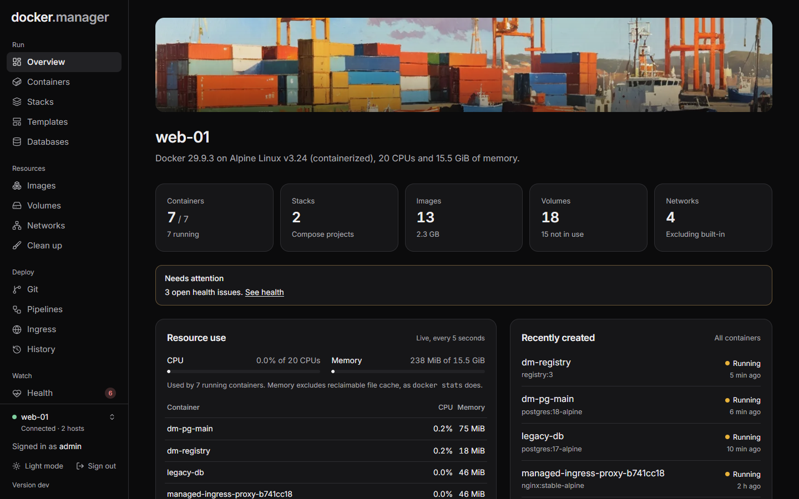

## Contents

- [Features](#features)
- [Screenshots](#screenshots)
- [Quick start](#quick-start)
- [Signing in](#signing-in)
- [Configuration](#configuration)
- [Databases](#databases)
- [Private registry](#private-registry)
- [Security scanning](#security-scanning)
- [Remote hosts](#remote-hosts)
- [Upgrading from 1.x](#upgrading-from-1x)
- [Development](#development)
- [License](#license)

## Features

**Run**

- Containers: start, stop, restart, logs, a shell, stats, and editing that keeps volumes and puts the original
  back if the new container doesn't start.
- Compose stacks: create, edit and redeploy, with every deploy kept as a version you can return to. Stacks started
  outside Docker Manager are detected and can be imported without restarting anything.
- Templates for common apps, a volume browser, and clean-up of unused images, volumes and networks.

**Deploy and publish**

- Git repositories and pipelines that build and deploy on push.
- Ingress: publish containers on your own domains through a built-in nginx proxy, with Let's Encrypt certificates
  that renew themselves, optional sign-in pages and per-route users.
- History of every change, with one-click undo.

**Data**

- PostgreSQL servers with secure defaults, a SQL console, users and per-database access, scheduled backups,
  restores, copies to S3-compatible storage, and import from the PostgreSQL containers you already run.
- A private Docker registry, served over HTTPS through ingress or on the server only.

**Watch and secure**

- Health monitoring with email alerts, and a live view of CPU and memory per container.
- Vulnerability scans of images with Trivy or Docker Scout, and host checks with Docker Bench for Security
  (the CIS Docker Benchmark), with one-click fixes you confirm first.
- Image rules that allow or block images, users with roles and per-host permissions, and an audit log.

**Hosts**

- Manage the local Docker host and remote hosts over TLS or SSH from one place.

## Screenshots

| | |
| --- | --- |
| 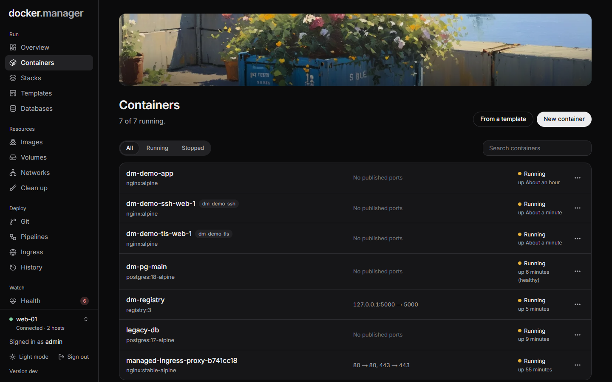 | 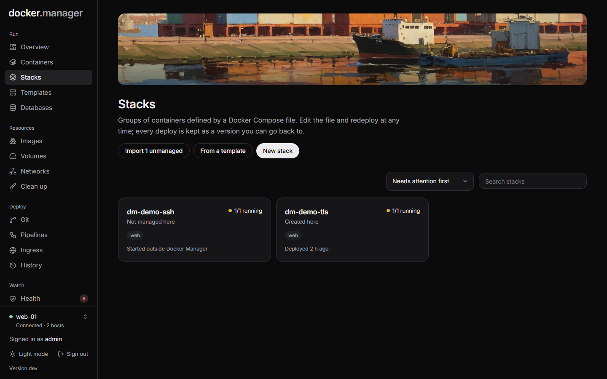 |
| Containers on a host | Compose stacks, including ones started elsewhere |
| 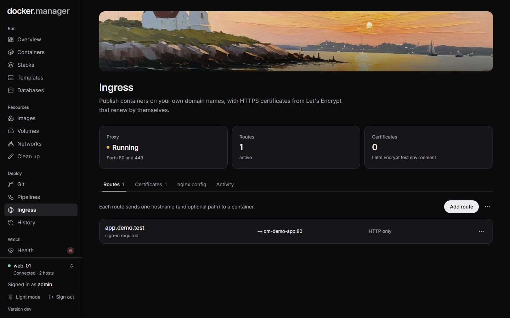 | 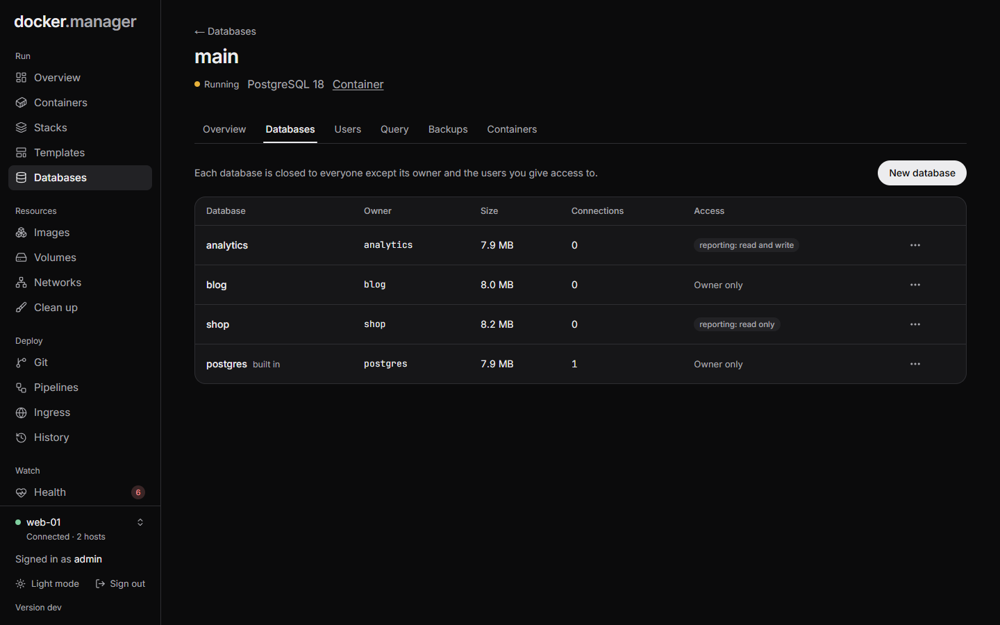 |
| Ingress routes with HTTPS and sign-in | Databases, owners and who can access them |
| 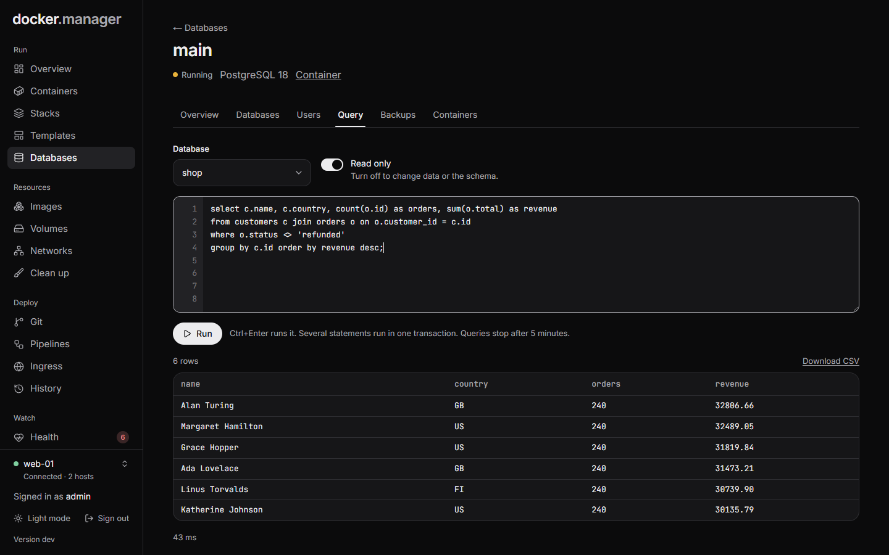 | 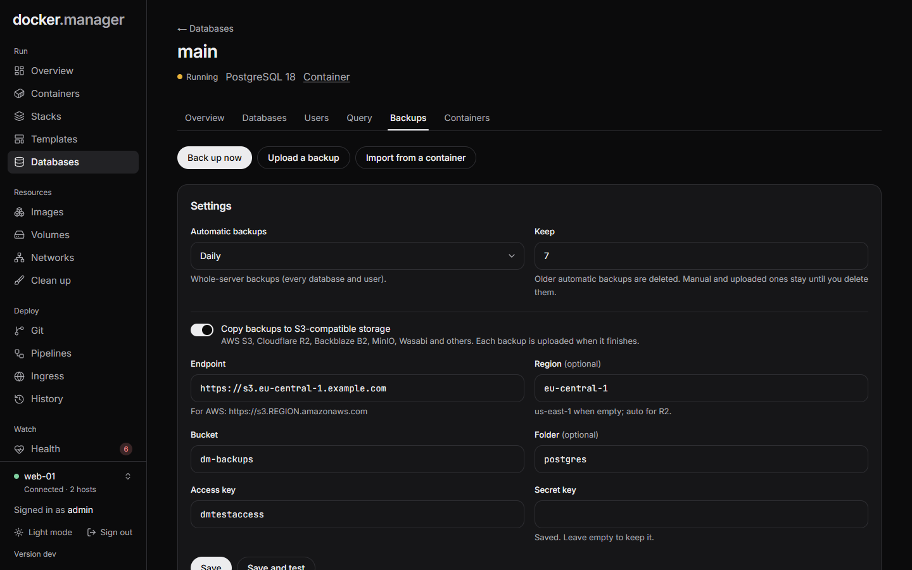 |
| The SQL console, read-only by default | Scheduled backups with copies to S3 |
| 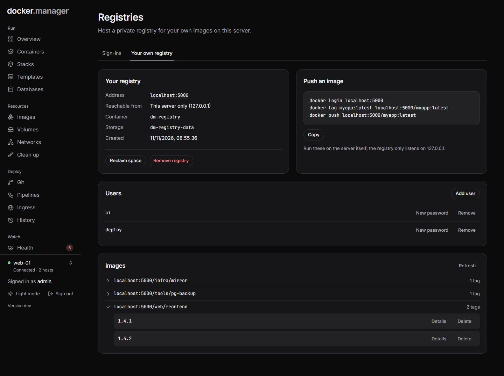 | 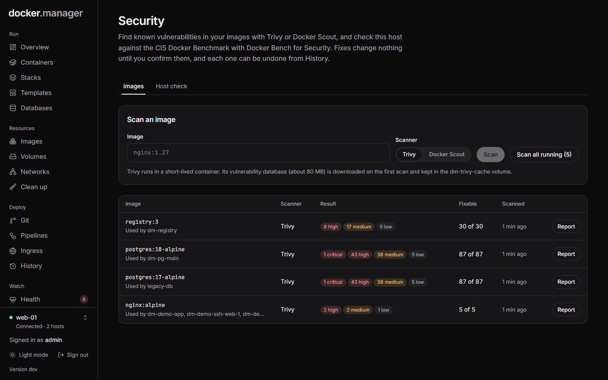 |
| Your own registry, its users and images | Vulnerability scans of the images in use |
| 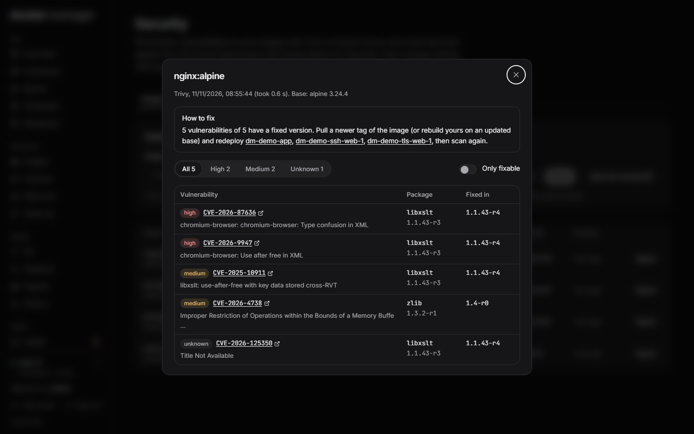 | 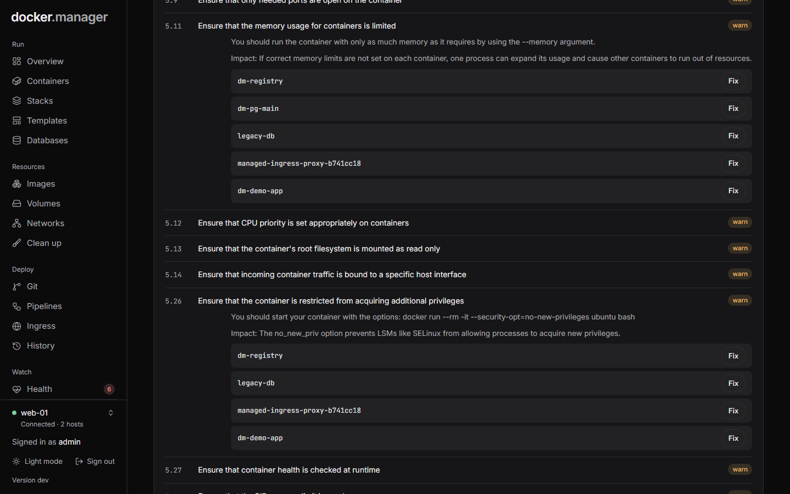 |
| A report with fixed versions and next steps | Host check findings with one-click fixes |

## Quick start

Create a `docker-compose.yml`:

```yaml
services:
  docker-manager:
    image: wannaverse/docker-manager:latest
    container_name: docker-manager
    pull_policy: always
    restart: unless-stopped
    ports:
      - "8080:8080"
    volumes:
      # Lets Docker Manager control this host's Docker
      - /var/run/docker.sock:/var/run/docker.sock
      # Database, database backups, and the secrets generated on first start
      - docker_manager_data:/app/database
      # Compose stacks and git checkouts. Keep the same path on both sides (see below)
      - /opt/docker-manager/stacks:/opt/docker-manager/stacks
      - /opt/docker-manager/git-repos:/opt/docker-manager/git-repos
    environment:
      # The address you open Docker Manager at; used for webhook URLs and email links
      - BASE_URL=http://your-domain.com
      # Optional: times in emails and logs (default UTC)
      # - TZ=Europe/London

volumes:
  docker_manager_data:
```

Then run `docker compose up -d` and open port 8080. The image has its own health check, and the Docker host whose
socket is mounted is added automatically on first start.

For a quick try without a compose file:

```
docker run -d -p 8080:8080 -v /var/run/docker.sock:/var/run/docker.sock wannaverse/docker-manager
```

## Signing in

The first user is `admin`. Its password is printed to the container logs on first start, and you choose your own
on first sign-in:

```
docker logs docker-manager
```

## Configuration

### Settings

| Variable | Default | Meaning |
| --- | --- | --- |
| `BASE_URL` | `http://localhost:8080` | Public address, used for webhook URLs and email links |
| `STACKS_DIR` | `/opt/docker-manager/stacks` | Where stack files are kept |
| `GIT_CLONE_DIR` | `/opt/docker-manager/git-repos` | Where git repositories are checked out |
| `TZ` | `UTC` | Time zone for emails and logs |
| `JWT_ACCESS_SECRET`, `JWT_REFRESH_SECRET`, `ENCRYPTION_KEY` | generated | See [Secrets](#secrets) |
| `JWT_ACCESS_EXP`, `JWT_REFRESH_EXP` | 15 minutes, 7 days | Session lengths in milliseconds |
| `API_DOCS_ENABLED` | `false` | Serves the OpenAPI description and Swagger UI |
| `CORS_ALLOWED_ORIGINS` | none | Only needed to run the UI from another origin during development |
| `LOG_LEVEL` | `INFO` | Server log level |

### Secrets

Strong random secrets for sign-in tokens and for encrypting stored credentials are generated on first start and
kept in the data volume (`/app/database/.secrets.properties`). To manage them yourself, set `JWT_ACCESS_SECRET`,
`JWT_REFRESH_SECRET` and `ENCRYPTION_KEY` to random values of at least 32 characters, for example from
`openssl rand -base64 48`.

Never reuse the example secrets that older versions of this README showed: they are public. Docker Manager
replaces public or weak JWT secrets with generated ones automatically.

### Stacks and git folders

Each stack's `compose.yaml` and `.env` are stored in `STACKS_DIR`, and git repositories are checked out to
`GIT_CLONE_DIR`. Docker resolves relative bind mounts in a compose file (like `./data:/data`) on the **host**, so
mount both folders at the same path on the host and in the container, as in the example above.

Stacks you import keep running from their original folder, so their relative paths still point at the same data.

### Behind a reverse proxy

- Put Docker Manager behind HTTPS before exposing it to the internet, and consider publishing its port only to the
  proxy (`127.0.0.1:8080:8080`).
- The proxy must send `X-Forwarded-For` and `X-Forwarded-Proto`. They are trusted from private addresses (Docker
  networks, LAN); for a proxy on a public address set `SERVER_TOMCAT_REMOTEIP_INTERNALPROXIES` to a regex matching
  it. Otherwise every visitor appears to come from the proxy, which shares one sign-in rate limit.
- Volume uploads can be up to 100 MB per file, and uploaded database backups can be larger. Raise the proxy's body
  size limit to match (nginx defaults to 1 MB, for example `client_max_body_size 2g;`).

### Docker Manager manages itself carefully

Docker Manager won't stop, remove, replace or disconnect its own container, and won't deploy or stop its own
compose project: compose runs inside it, so it would go offline halfway with nothing to bring it back. Update it on
the server with `docker compose pull && docker compose up -d`.

## Databases

**Databases** runs PostgreSQL servers (versions 16, 17 and 18, Alpine images) so that many apps can share one server
instead of each running its own.

**Secure defaults.** Each server gets a random 32-character administrator password and uses SCRAM-SHA-256 for every
login. It publishes no port unless you ask for one (on 127.0.0.1 or on every interface); apps reach it on its own
Docker network by its container name, `dm-pg-NAME:5432`. Every database is closed to everyone but its owner and the
users you allow, including the built-in `postgres` database. Passwords are sent to PostgreSQL as SCRAM verifiers, so
they never appear in its logs.

**Working with it.** Create a database together with its own user (the password is shown once), give other users
read-only or read and write access, and run queries in a console that is read-only until you switch it off.
Connect containers to the server's network from the **Containers** tab, which also shows the lines to add to a
compose file so the connection survives redeploys. A user that still owns a database or tables can't be deleted, so
no data is ever deleted along with a user.

**Backups.** Whole-server backups (every database and user, `pg_dumpall`) run daily by default and the newest seven
are kept; the schedule and retention can be changed. Single databases can be backed up on demand (`pg_dump`
custom format). Backups are stored in the data volume under `/app/database/db-backups`, can be downloaded, and can
be copied to S3-compatible storage (AWS S3, Cloudflare R2, Backblaze B2, MinIO, Wasabi and others) as each one
finishes.

**Restoring.** A whole-server backup replaces the databases it contains and leaves the others alone; a
single-database backup is restored into the database you name, owned by the user you choose. A safety backup of the
whole server is taken before every restore. You can also upload a backup made elsewhere: plain SQL (gzipped or not)
or `pg_dump` custom format.

**Bringing existing databases in.** **Import from a container** copies a database out of another PostgreSQL
container on the same host (signing in with that container's own `POSTGRES_USER` and `POSTGRES_PASSWORD`) and
restores it under a new owner. The source container is only read, so you can switch the app over and remove the old
container when you're ready.

## Private registry

**Registries > Your own registry** runs the official `registry:3` image (CNCF Distribution) on the selected host:

- **Anywhere, over HTTPS:** served through ingress on a hostname you choose, with a Let's Encrypt certificate and no
  upload size limit. Ingress must be turned on, the hostname's DNS must point at the server, and ports 80 and 443
  must be reachable.
- **This server only:** published on `127.0.0.1`, which Docker accepts without HTTPS. Enough when images are built
  and run on the same machine.

Pushing and pulling always need a sign-in; passwords are stored as bcrypt hashes and changes apply without
restarting the registry. Docker Manager adds the registry under **Sign-ins** with its own account, so deployments
can pull from it straight away. You can browse repositories and tags, delete tags, and reclaim the disk space they
used.

## Security scanning

**Security** brings three tools together. Each runs in a short-lived container on the host it checks.

- **Trivy** (`aquasec/trivy`) scans an image, or every image your running containers use, for known
  vulnerabilities, and shows which ones have a fixed version. Its vulnerability database is kept in the
  `dm-trivy-cache` volume between scans.
- **Docker Scout** gives a second opinion on images. It needs a Docker Hub sign-in under **Registries** (a personal
  access token works).
- **Docker Bench for Security** checks the host, the Docker daemon's settings and every running container against
  the CIS Docker Benchmark. It mounts the host's configuration read-only and changes nothing.

Where a finding can be fixed safely, a **Fix** button explains exactly what will change and does nothing until you
confirm. Container fixes (blocking privilege escalation, limiting processes, limiting memory) recreate the container
with the same image, volumes and networks, put the original back if the new one doesn't start, and can be undone
from **History**. Containers that belong to a stack get the line to add to their compose file instead. Daemon-level
findings come with a suggested `daemon.json`, which you apply on the server yourself, because a mistake there would
stop Docker from starting.

## Remote hosts

Add other Docker servers under **Hosts**:

- **TLS** (`tcp://host:2376`): paste the CA certificate, client certificate and client key. This is Docker's own
  way of protecting a remote daemon.
- **SSH** (`ssh://user@host`): paste a private key. Docker Manager opens a tunnel to the remote Docker socket, so
  the server needs `AllowTcpForwarding yes` in its SSH configuration.
- **Plain TCP** (`tcp://host:2375`) gives full control of the host to anyone who can reach that port, without a
  password. Use it only on a private network or VPN.

## Upgrading from 1.x

- **Back up first:** copy the `docker_manager_data` volume. On its first start 2.0 also keeps a copy of the
  database next to it (`data.db.before-2.0-migration`) before adapting its tables.
- **`ENCRYPTION_KEY`:** registry passwords, git tokens and the SMTP password are encrypted with it.
  - If your 1.x compose file had the example value from the old README, or no key at all, you can drop it: 2.0
    still reads credentials saved with those, and uses a strong generated key for anything saved from now on.
  - If you set **your own** value, keep that exact line in the new compose file, or those credentials can't be
    read and have to be entered again.
- **Folders:** add the two `/opt/docker-manager/...` mounts from the example above. Without them stacks are kept
  inside the container and relative paths in compose files point at empty folders.
- Everyone signs in again once: sign-in tokens are now derived differently.
- Compose deployments made with 1.x were never saved anywhere; they show up under **Stacks** as "not managed
  here". Use **Find the compose file** on the stack page, or **Import all** on the Stacks page, to manage them.
  Importing never restarts anything, and an imported stack deploys without removing services it doesn't know about.
- Git repositories that deploy a Dockerfile now also run the built image. Check their container settings.
- Creating and editing users, groups, git repositories, pipelines and compose files is now limited to
  administrators.

## Development

The server is Spring Boot (Java 25) in `src/`; the UI is a Next.js static export in `frontend/`.

```
# Server on :8099, allowing the dev UI's origin
SERVER_PORT=8099 CORS_ALLOWED_ORIGINS=http://localhost:3099 ./gradlew bootRun

# UI on :3099 (reads NEXT_PUBLIC_API_BASE from frontend/.env.development)
cd frontend && npm install && npm run dev
```

`npm run build` in `frontend/` writes `frontend/out`, which `./gradlew bootJar` bundles into the jar. The Docker
image does both. Run the tests with `./gradlew test`.

Docker Bench for Security is included under `src/main/resources/bench` (Apache License 2.0, see the `LICENSE.md`
and `SOURCE.md` there), because its published image can no longer talk to current Docker versions.

## License

MIT. See [LICENSE](https://github.com/WannaverseOfficial/docker-manager/blob/main/LICENSE) for details.

## Contributing

Contributions are welcome. Open an issue to report a problem or suggest a feature, or send a pull request.
