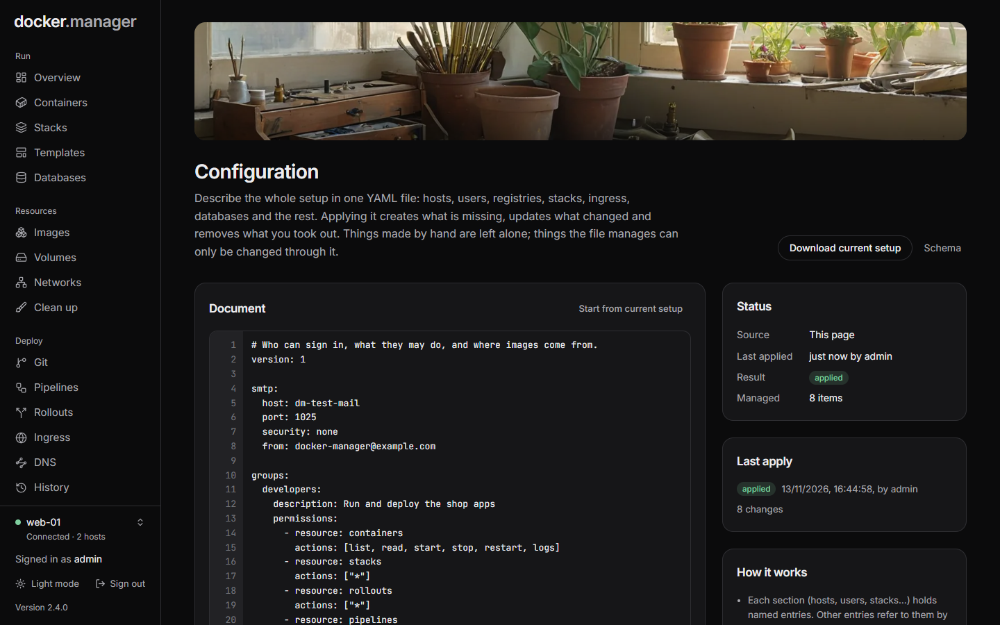

Docker Manager's whole setup can be described in one YAML file: hosts, users and groups, registries, image rules,
templates, networks, volumes, containers, stacks, DNS zones and records, ingress with its routes and certificates,
databases, observability, rollouts, git repositories and pipelines. Applying the file creates what is missing,
updates what changed and removes what you took out of it, in the right order. Think of it as CloudFormation or
Terraform for Docker Manager.

**Why use it?**

- **Review changes before they happen.** Every change shows up as a preview first, and in a pull request if the file
  lives in git.
- **Rebuild a server in minutes.** The file plus your secrets is everything needed to set up a new installation the
  same way.
- **No drift.** Things the file manages are locked in the UI, and anything removed by other means is put back.

Configuration as code is for administrators. This page is the guide; every section and setting is listed in the
[configuration file reference](/docs/reference/configuration-file/).



## Two ways to use it

### From the Configuration page

Without a file, administrators write or paste the document on the **Configuration** page:

1. Write the document, or press **Start from current setup** to fill the editor with what you have today.
2. Press **Preview changes**. Nothing changes yet: the preview lists each entry with what applying would do (**create**,
   **take over**, **update**, **re-create**, **delete**, **stop managing** or **unchanged**), and any problems.
3. Press **Apply**. The run shows each entry as it is applied. If the preview includes deletions, you confirm them
   first.

The document is kept (encrypted), and every 5 minutes Docker Manager puts back managed things that were removed by
other means. **Download current setup** saves today's setup as `docker-manager.yaml`.

### From a file (GitOps)

Mount the file into the container and point `DM_CONFIG_FILE` at it:

```yaml
services:
  docker-manager:
    image: wannaverse/docker-manager:latest
    environment:
      DM_CONFIG_FILE: /config/docker-manager.yaml
      ALICE_PASSWORD: ${ALICE_PASSWORD}
    volumes:
      - ./docker-manager.yaml:/config/docker-manager.yaml:ro
      # ...the usual volumes
```

Docker Manager applies the file at startup, and again within about 20 seconds whenever it changes (once it has read
the same content twice, so a file caught halfway through being saved is never applied). The **Configuration** page then
shows the file read-only, with the result of each apply and an **Apply again now** button. Keep the file in git and
deploy it like any other file.

| Variable | Default | Meaning |
| --- | --- | --- |
| `DM_CONFIG_FILE` | none | The configuration file to apply. Without it, use the Configuration page. |
| `DM_CONFIG_RECONCILE_SECONDS` | `300` | How often to put back managed things removed by other means. `0` turns it off. |

## A first file

```yaml
version: 1

hosts:
  local:
    url: unix:///var/run/docker.sock

groups:
  developers:
    permissions:
      - resource: containers
        actions: [list, read, start, stop, restart, logs]
      - resource: stacks
        actions: [list, read, deploy, logs]

users:
  alice:
    email: alice@example.com
    password: ${env:ALICE_PASSWORD}
    groups: [developers]

stacks:
  whoami:
    compose: |
      services:
        whoami:
          image: traefik/whoami
          networks: [web]
      networks:
        web:
          external: true

ingress:
  local:
    acmeEmail: ops@example.com
    routes:
      whoami:
        hostname: whoami.example.com
        container: whoami-whoami-1
        port: 80
        tls: lets-encrypt
```

Every file starts with `version: 1`. Each section holds named entries; the name (the key) is how other entries refer
to them, and usually also the name the resource gets in Docker Manager (an explicit `name:` overrides it). Settings
left out take their defaults. Keys starting with `x-` are ignored, so YAML anchors can live there:

```yaml
x-defaults: &web
  restart: unless-stopped
  networks: [web]

containers:
  api:
    <<: *web
    image: ghcr.io/acme/api:1.4.0
```

## How applying works

**Ownership.** Docker Manager remembers what the file created or took over. Removing an entry from the file deletes
what it made; things made by hand in the UI are never touched. When an entry describes something that already exists
(a user with the same name, a stack with the same name on the same host...), applying **takes it over** instead of
creating a duplicate. A takeover changes only what the entry says: a user taken over without `admin:` or `groups:`
keeps them until the entry mentions them.

**Renaming and moving.** Changing an entry's key while it still describes the same thing (for example `web:` becoming
`frontend:` with `name: web`) only renames the entry; nothing is re-created. Moving a container, stack or network to
another host, or renaming a stack or network, is refused, because it would mean making a new one and deleting the old
one with its data: add a new entry and remove the old one, so the preview shows both.

**Data is kept.** Removing a database server, volume, hosted registry, observability stack or DNS zone from the file
only stops managing it, unless its entry said `onRemove: delete` (or `delete-data`, which also removes its data
volumes and backups) when it was last applied. To delete one: set `onRemove: delete`, apply, then remove the entry.

**Order.** Entries are applied in dependency order: SMTP, hosts, groups, users, registries, image rules, templates,
networks, volumes, DNS (settings, health checks, zones, records), ingress, certificates, databases, containers, stacks,
hosted registries, observability, rollouts, git repositories, pipelines, and routes last. Removals run in the reverse
order, and only when everything else applied without errors, so a typo never deletes half your setup. If a removal
fails (a network a container still uses, say), the sections below it wait for the next apply, so a host is never
removed while something on it is still managed.

**Changes.** Only entries whose settings changed since they were last applied are touched. A container whose settings
differ from the running one is re-created the same way the UI does it, keeping the networks that ingress, databases
and observability connected it to. After the changes, links between entries are checked again (a database's
`containers:` list naming a container that a later section created, say) and made. An entry that failed is tried
again when the file changes or someone chooses **Apply again now**. The 5-minute check only re-creates missing things
and re-makes links; it doesn't retry a change that already failed with the same file, since retrying a container
change means stopping the container each time.

**Problems stop everything.** A file with an error (bad YAML, an unknown setting, a missing variable, a reference to
nothing) is not applied at all. Previews and the Configuration page show each problem with where it is, such as
`users.alice.groups: there is nothing called "devs" in groups`.

**Not configuration.** Applying never starts a rollout release, a deployment or a pipeline run, and never drops a
database, a role or data. Users still change their own passwords (a password set in the file is applied again only
when it changes in the file).

## Locked in the UI

Things the file manages show a **Config file** badge, and their edit and delete buttons are gone; the API refuses such
changes with `409 MANAGED_BY_CONFIG`. Everyday actions still work: starting and stopping containers, deploying stacks,
releasing rollouts, running pipelines, backups, queries.

To change a managed thing, change the file. To hand it back to the UI, remove its entry: things with data are kept
(see above), and everything else is deleted, so take care.

## Secrets

Never put passwords in the file itself. String values can refer to:

| Reference | Value |
| --- | --- |
| `${env:NAME}` | Docker Manager's environment variable `NAME` (applying fails if it isn't set) |
| `${env:NAME:-fallback}` | The same, with a value to use when it isn't set |
| `${file:/run/secrets/name}` | A file's contents without the trailing newline: Docker or Kubernetes secrets. Relative paths are read next to the configuration file. |
| `$${...}` | A literal `${...}` |

Other `${...}` text, such as a compose file's own `${VARIABLE}`, is left alone. Compose's own escape `$${VAR}` is
written `$$${VAR}`.

Docker Manager's own keys (`ENCRYPTION_KEY`, `JWT_*`) and files in its data folder can't be read this way.

Secrets are never written back out. What was last applied is remembered with a keyed hash in place of each secret, so
changing a password in the environment still counts as a change. Exports write `${env:...}` placeholders for passwords
and keys, and list the variables they need. Container, stack and pipeline variables are exported as they are, except
those named like secrets (`*PASSWORD*`, `*TOKEN*`, `*KEY*`, `*SECRET*`...): check the others before committing an
export. Problems are reported without repeating the value, and passwords generated by a file or scheduled apply
(nobody is there to see them) are written to the log, like the first administrator's.

## Referring to other entries

- `host:` takes a key of `hosts:`, or the name or id of a host added by hand. Leave it out when there is only one host.
- `groups:` on a user, `repository:` on a pipeline, `rollout:` on a git repository and so on take the key of that
  entry, or the name of one made by hand.
- Per-host sections (`ingress`, `hostedRegistries`, `observability`) are keyed by the host.
- Routes and certificates live inside their host's `ingress` entry.

## Switching an existing installation over

1. On the **Configuration** page, choose **Start from current setup** (or **Download current setup**). The export
   describes everything you have, with placeholders for secrets.
2. Trim what you don't want managed, set the listed environment variables (or replace them with `${file:...}`), and
   **Preview changes**. Entries that match something existing show **take over**, not **create**.
3. **Apply**. From then on, change things in the file.

## Editor support

The schema at `/api/config/schema` gives completion, checking and hover help in editors that read YAML schemas (the
**Schema** link on the Configuration page opens it). In VS Code with the YAML extension, add this first line to the
file, with your own Docker Manager address:

```yaml
# yaml-language-server: $schema=https://docker.example.com/api/config/schema
```

## The API

The same works over the API:

| Method and path | What it does |
| --- | --- |
| `POST /api/config/plan` `{"yaml": "..."}` | What applying would change. Changes nothing. |
| `POST /api/config/apply` `{"yaml": "..."}` | Starts applying; returns the run, with its id |
| `GET /api/config/runs/{id}` | Progress and result of a run |
| `POST /api/config/reapply` | Applies the current document again now |
| `GET /api/config/export` | Today's setup as a configuration file |
| `GET /api/config/schema` | The file's JSON schema (public) |
| `GET /api/config` | The current document and the last result |

All of them except the schema need an administrator's token.

## Next

- [Configuration file reference](/docs/reference/configuration-file/): every section and setting, and a complete
  example.
- The feature pages each end with how to describe that feature in the file, for example [DNS](/docs/deploy/dns/) and
  [Rollouts](/docs/deploy/rollouts/).
