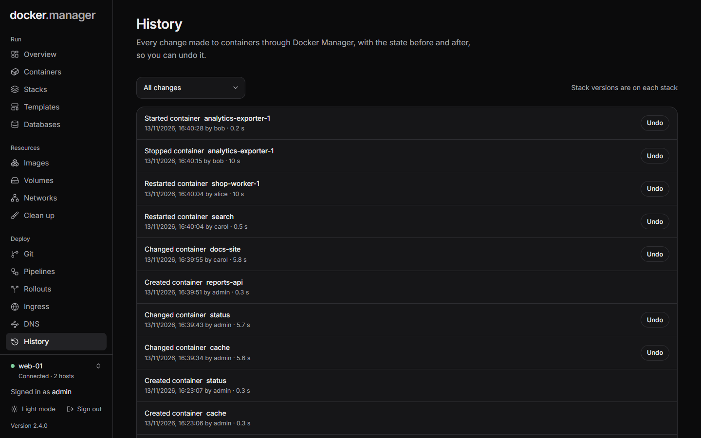
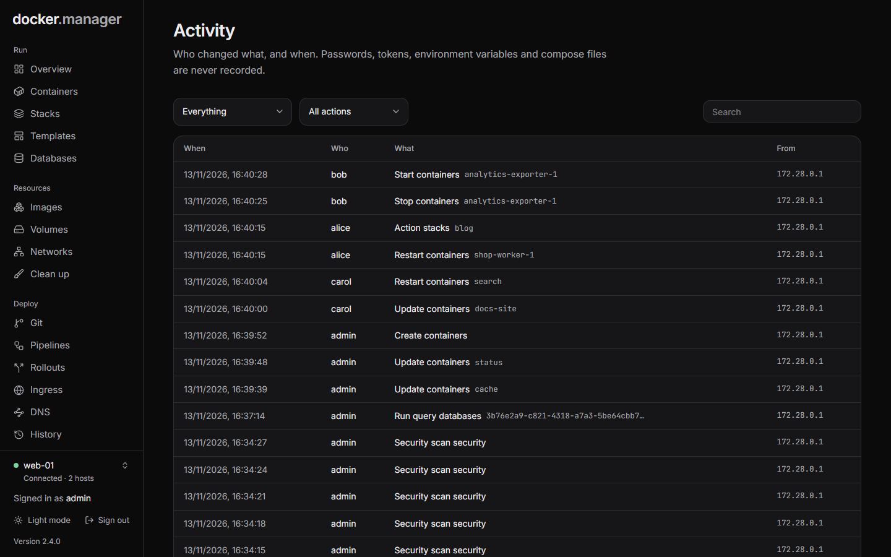

Docker Manager keeps two records: **History**, the changes made to containers with what they looked like before
and after, so you can undo them; and **Activity**, a log of who did what, when and from where.

## History

**History** (under **Deploy** in the sidebar) lists every change made to containers on the selected host through
Docker Manager: created, changed, started, stopped, restarted and removed containers, and stacks deployed and taken
down. Each entry shows when it happened, who did it and how long it took. Use the menu at the top to show one kind of
change.

### Undo a change

1. Find the change in **History**, or on the container's own **History** tab.
2. Choose **Undo** and confirm.

What undo does depends on the change:

| Change | Undo |
| --- | --- |
| Created a container | The container is removed. |
| Changed a container | The container goes back to how it was before. |
| Removed a container | The container is recreated from its saved settings. Data in named volumes is still there; data that only lived inside the container is not. |

Undone changes are marked **undone**, and failed ones **failed**. **Undo** is only offered for changes that can be
undone.

### Stack versions

Stacks keep their own history: every deploy is saved as a version on the stack's **Versions** tab, where you can
**Roll back** to an earlier compose file. See [Compose stacks](/docs/run/stacks/#go-back-to-an-earlier-version).

### How long history is kept

Container history, finished git deployments and pipeline runs, and the ingress log are kept for 90 days. Resolved
health events are kept for 30 days.

## Activity

**Activity** (administrators only, under **Watch**) shows who changed what, and when: changes such as creating, changing,
deleting and deploying things, and the commands run in containers' consoles, with the user (or **system**) and the address it came
from.

Filter it by **Area** (containers, stacks, users and so on) and **Action**, or search it. Failed actions are marked
**failed**.

Passwords, tokens, environment variables and compose files are never recorded.
