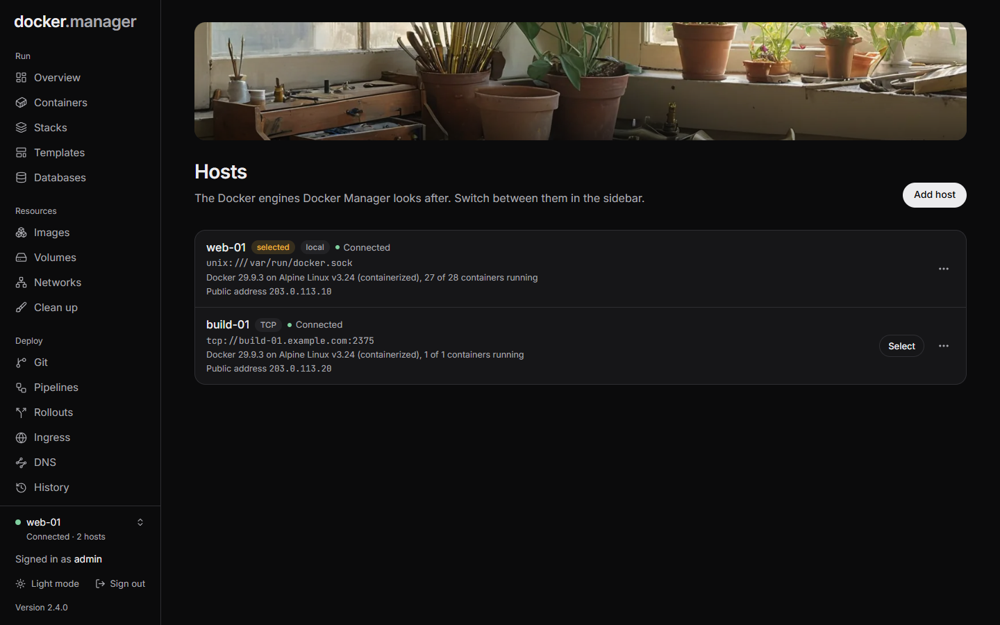

**Hosts** lists the Docker engines Docker Manager looks after. One Docker Manager can look after several servers;
switch between them at the bottom of the sidebar.

Each host shows how it's connected (**local**, **SSH**, **TLS** or **TCP**), whether it's **Connected** or **Not
reachable**, its Docker version and operating system, how many containers are running, and its public address if
it has one.

## The local host

When the Docker socket is mounted into Docker Manager's container (`/var/run/docker.sock`, as in the
[install example](/docs/start/install/)), the server it runs on is added automatically on first start.

## Add a remote host

1. On **Hosts**, choose **Add host**.
2. Give it a **Name** (optional), like `Home server`.
3. Under **Connect with**, choose **SSH**, **TCP with TLS**, **TCP** or **This server**, and fill in the details
   below.
4. Choose **Connect**.

### SSH

Docker Manager signs in over SSH and opens a tunnel to the remote Docker socket.

- **User**: a user in the `docker` group on the server, like `deploy`.
- **Server** and **Port** (22 by default).
- **Private key**: an OpenSSH key without a passphrase, whose public key is in that user's
  `~/.ssh/authorized_keys`. It's stored encrypted.

The server's identity is remembered on the first connection and checked every time after.

:::note
The server needs `AllowTcpForwarding yes` in its SSH configuration (`/etc/ssh/sshd_config`), because the
connection to Docker goes through an SSH tunnel.
:::

### TCP with TLS

This is Docker's own way of protecting a remote daemon (`tcp://host:2376`). Paste the three files you made when you
[set up TLS on the daemon](https://docs.docker.com/engine/security/protect-access/):

- **CA certificate** (`ca.pem`)
- **Client certificate** (`cert.pem`)
- **Client key** (`key.pem`)

### TCP

Plain TCP (`tcp://host:2375`) works, but Docker's plain TCP port gives full control of the server to anyone who can
reach it, with no password. Only use it on a private network or VPN, or choose SSH or TLS.

## Public address

A host's **Public IPv4** and **Public IPv6** are the addresses that [DNS](/docs/deploy/dns/) records for its
[ingress routes](/docs/deploy/ingress/) point at. Fill them in when you add or edit a host, or choose **Detect**:
Docker Manager asks a public service from the host, which can take up to 20 seconds. Detection only runs when you
choose it.

## Edit or remove a host

Administrators can use a host's menu to **Edit** its name and public address, or **Remove** it.

Removing a host only means Docker Manager stops managing it: its containers keep running. Stacks, routes and
repositories set up for it stop working in Docker Manager.

Hosts can also be described in the [configuration file](/docs/admin/configuration-as-code/). Hosts managed that way
are marked **Config file** and can only be changed through the file.
