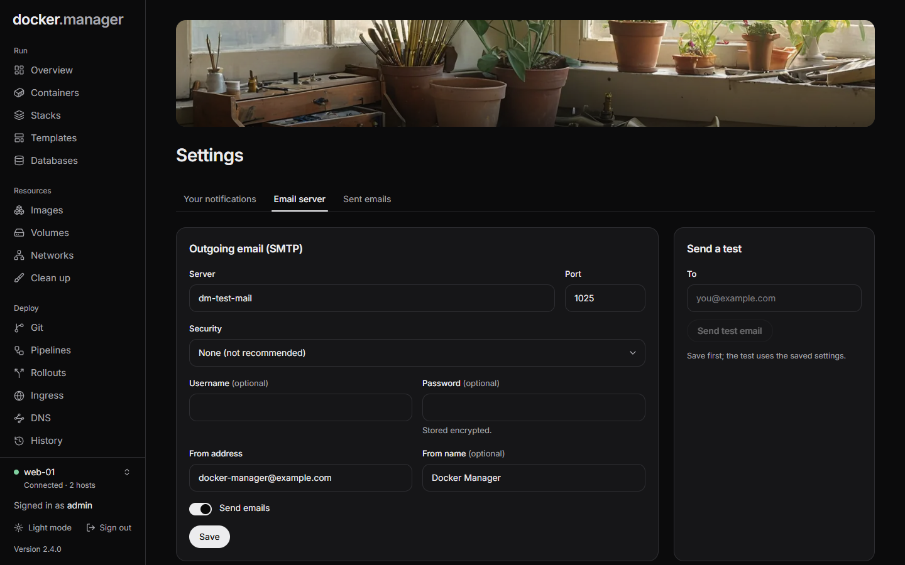

**Settings** has three tabs: **Your notifications** for everyone, and **Email server** and **Sent emails** for
administrators.

## Set up email

Docker Manager sends emails about failed deployments, containers that stop or fail health checks, hosts that
disconnect, failed database backups and more. Nothing is sent until an administrator sets up an email server.

1. Open **Settings** and choose **Email server**.
2. Fill in **Outgoing email (SMTP)**:
   - **Server** and **Port** of your mail provider's SMTP server.
   - **Security**: **STARTTLS** (usually port 587), **TLS** (usually port 465), or **None** (not recommended).
   - **Username** and **Password**, if the server needs them. The password is stored encrypted; when one is saved,
     leave the field empty to keep it.
   - **From address**, like `docker@example.com`, and optionally a **From name**.
3. Turn on **Send emails** and choose **Save**.
4. Under **Send a test**, enter your address in **To** and send a test. The test uses the saved settings, so save
   first.

**Sent emails** lists every email Docker Manager sent, and whether sending worked.

## Your notifications

Each person chooses which emails they get on the **Your notifications** tab. Everything is on until you turn it
off.

| Area | Notifications |
| --- | --- |
| Deployments | Deployment Started, Deployment Completed, Deployment Failed |
| Containers | Container Stopped Unexpectedly, Container Health Check Failed, Container Restart Loop, Container OOM Killed |
| Security | User Login, Password Changed |
| System | Host Disconnected, Host Reconnected |
| Databases | Database Backup Failed |
| DNS | DNS Health Check Changed |

Emails go to the address on each user's account. People who aren't administrators only hear about the hosts they
have access to, and some notifications, like failed database backups, only go to administrators.

:::note
The first administrator, `admin`, is created with the address `admin@localhost`, which can't receive mail.
:::

## Health monitoring settings

How often containers are checked, and what counts as a restart loop, are set with environment variables
(`DOCKER_HEALTH_MONITOR_*`). See [Environment variables](/docs/reference/environment/#health-monitoring) and
[Health](/docs/watch/health/).
