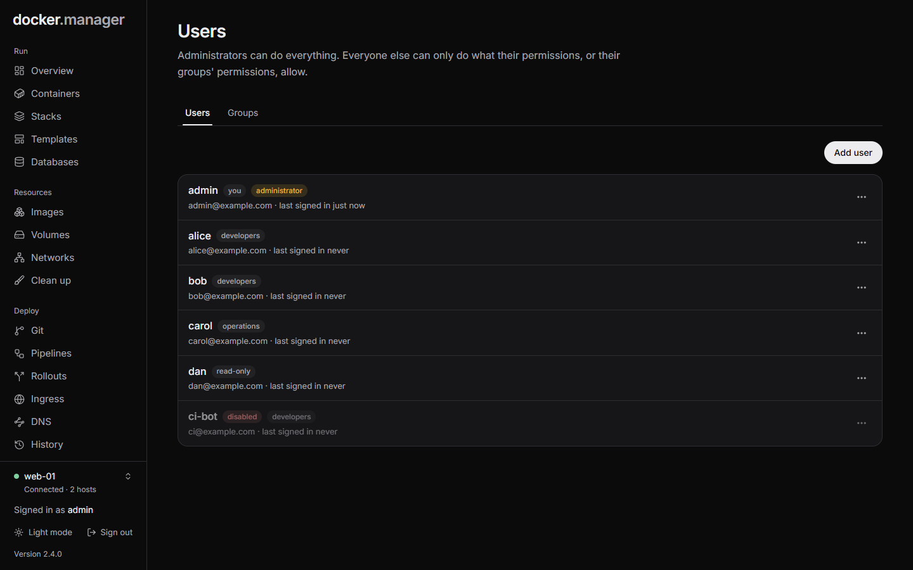

**Users** (administrators only) is where you add people and decide what they can do. Administrators can do
everything. Everyone else can only do what their permissions, or their groups' permissions, allow.

## Add a user

1. Open **Users** and choose **Add user**.
2. Enter a **Username** and, optionally, an **Email** (used for notifications).
3. Turn on **Administrator** only if they should be able to do everything, including managing users.
4. Choose **Add user**.

Docker Manager shows a **temporary password**. Give it to them privately: it isn't shown again. They choose their
own password the first time they sign in. Until then, the user is marked **temporary password**.

A new user who isn't an administrator has no permissions yet: they can sign in but see nothing. Give them
permissions next.

## Give permissions

1. In the user's menu, choose **Permissions**.
2. Under **Grant a permission**, choose:
   - **Area**: what it's about, like Containers, Stacks, Images, Volumes, Git repos or Ingress routes.
   - **Action**: **Everything**, or one action, like List, Read, Start, Stop, Logs or Deploy. The actions offered
     depend on the area.
   - **Host**: **All hosts**, or one host.
   - **Only this item** (optional): a container or stack name, for example, to limit it to one thing. Leave it
     empty for all.
3. Choose **Grant**. Repeat for each permission, then **Done**.

For example, to let someone look after one app on one server, grant **Everything** on Containers and on Stacks for
that host, with **Only this item** set to the app's stack and container names.

Remove a permission with the **×** next to it.

## Groups

Groups give the same permissions to several people.

1. Open **Users** and choose the **Groups** tab.
2. Under **New group**, enter a **Group name** (like `Developers`) and choose **Create**.
3. Choose **Permissions** next to the group and grant permissions as for a user.
4. On the **Users** tab, add people to it from each user's menu with **Add to ...**.

A user's permissions are their own plus those of every group they're in. Deleting a group removes the permissions
its members had through it.

## Manage users

Each user's menu has:

- **Edit**: change their **Username** (used at their next sign-in) or **Email** (where their notifications go;
  leave it empty for none). Two users can't share an address. An address that can't receive mail, like
  `admin@localhost`, is shown in the list.
- **Permissions** (not for administrators, who can already do everything)
- **Make administrator** or **Remove administrator**
- **Disable** or **Enable**: a disabled user is signed out and can't sign in until enabled again.
- **Reset password**: they're signed out and must choose a new password with the temporary one you give them.
- **Add to ...** and **Remove from ...** for each group
- **Delete**

You can't make yourself not an administrator, disable yourself or delete yourself.

## What only administrators can do

Some things are limited to administrators whatever permissions someone has, because they could otherwise be used to
gain more access:

- Managing users, groups and permissions
- Creating and editing Compose stacks (other users with permission can deploy, start and stop them)
- Creating and editing git repositories and pipelines
- Mounting host folders into containers
- Browsing the files in volumes
- Docker Manager's own container: its logs, settings and console
- The pages Databases, Clean up, DNS, Observability, Security, Activity and Configuration

## Your account

Everyone can open **Your account** from their name at the bottom of the sidebar:

- **Password**: change your password (at least 8 characters). Your other sessions are signed out.
- **Email**: change or remove the address your notifications go to. Enter your password to confirm.
- **Sessions**: **Sign out everywhere** signs you out on every browser and device, including this one.

Users, groups and their permissions can also be described in the
[configuration file](/docs/admin/configuration-as-code/). Users managed that way are marked **Config file** and can
only be changed through the file.
