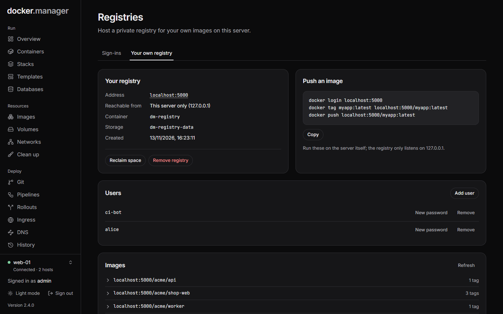

The **Registries** page has two tabs:

- **Sign-ins**: credentials for private images on Docker Hub, GitHub, GitLab, cloud registries and others.
- **Your own registry**: a private registry for your own images, run on the server (administrators).

## Sign-ins

Public images need no sign-in. To pull private images, press **Add registry** and choose the **Type**:

| Type | What to enter |
| --- | --- |
| **Docker Hub** | **Username** and an **Access token**. |
| **Other registry (GitHub, GitLab, Harbor…)** | The **Registry address** (such as `ghcr.io`), **Username**, and **Password or token**. |
| **Amazon ECR** | The registry address and a token from `aws ecr get-login-password`. ECR tokens expire after 12 hours: paste a fresh one when pulls start failing. |
| **Google Artifact Registry** | The registry address (such as `europe-docker.pkg.dev`) and a service account JSON key. |
| **Azure Container Registry** | The registry address, **Client ID**, **Client secret** and optional **Tenant ID**. |

Sign-ins are used automatically when an image comes from that registry, and only for it: credentials are only sent to
that exact host. Passwords and tokens are stored encrypted. **Use this registry** turns a sign-in off without
deleting it.

A Docker Hub sign-in also lets [Docker Scout](/docs/watch/security/) scan images.

## Your own registry



**Your own registry** runs the official `registry:3` image (CNCF Distribution) on the selected host. Choose where it
is **Reachable from**:

- **Anywhere, over HTTPS**: served through [ingress](/docs/deploy/ingress/) on a **Hostname** you choose, such as
  `registry.example.com`, with a Let's Encrypt certificate and no upload size limit. Ingress must be turned on, the
  hostname's DNS must point at the server, and ports 80 and 443 must be reachable.
- **This server only**: published on a **Port** on `127.0.0.1`, which Docker accepts without HTTPS. Enough when
  images are built and run on the same machine.

Add the **First user** and a **Password** (at least 10 characters), then press **Create registry**. Docker Manager adds
the registry under **Sign-ins** with its own account, so your deployments can pull from it straight away.

### Push an image

The registry's page shows the commands to push, with its address filled in:

```bash
docker login registry.example.com
docker tag myapp:latest registry.example.com/myapp:latest
docker push registry.example.com/myapp:latest
```

With **This server only**, run them on the server itself, since the registry only listens on `127.0.0.1`.

### Users and images

- Pushing and pulling always need a sign-in. **Add user** adds someone who can push and pull, and **New password**
  changes a password. Changes take effect right away, without restarting the registry. Passwords are stored as bcrypt
  hashes.
- **Images** lists the repositories and their tags. Deleting a tag frees its space once you **Reclaim space**, which
  deletes the layers no tag uses any more. The registry stops for the few seconds this takes, so don't run it during a
  push.

Images are stored in the `dm-registry-data` volume.

### Remove the registry

**Remove registry** removes the registry container, its route and its sign-in entry. Deployments that pull from it will
fail. The images are kept in the `dm-registry-data` volume, and a new registry picks them up again, unless you tick
**Also delete the stored images**.

## In the configuration file

Sign-ins go under `registries` and your own registry under `hostedRegistries` in the
[configuration file](/docs/admin/configuration-as-code/). See the
[reference](/docs/reference/configuration-file/#registries).
