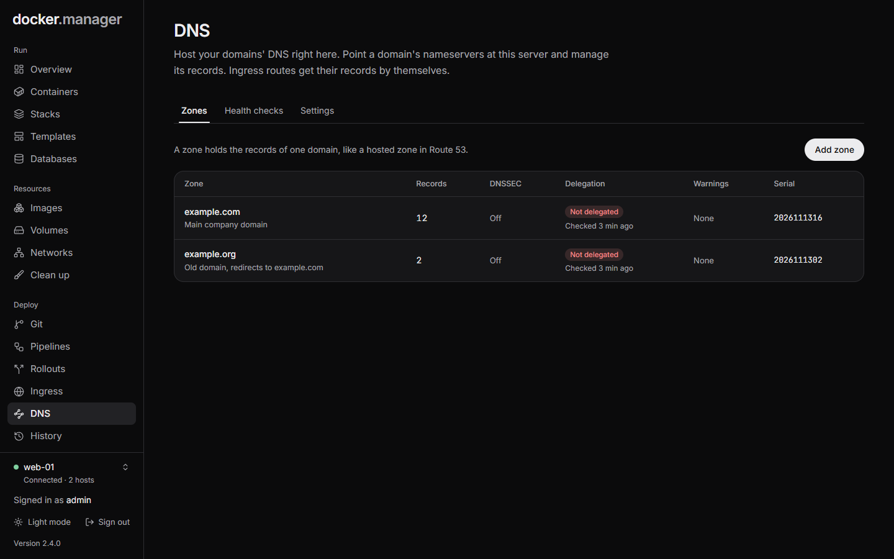
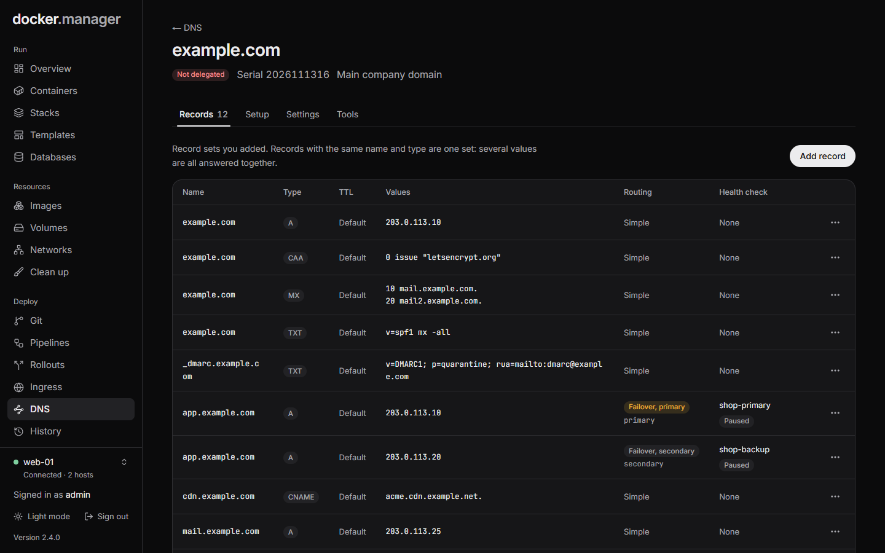

Docker Manager can answer DNS for your domains itself, like Route 53 hosted zones. Point a domain's nameservers at
your server, and Docker Manager becomes the place its records live. Because it also runs your ingress, rollouts,
registry and Grafana, it fills in their records by itself: expose an app on `shop.example.com` and the name points at
the right host a moment later, with no trip to your DNS provider.

What you get:

- **Hosted zones and record sets**: A, AAAA, CNAME, MX, TXT, SRV, CAA, NS (delegations), PTR and DS.
- **Automatic records** for every ingress route under a hosted domain, including the routes rollouts, the hosted
  registry and Grafana make. They point at the public address of the route's host.
- **Routing policies** as in Route 53: simple, weighted (share answers between servers) and failover (answer with a
  backup while the main server fails its health check).
- **Health checks** over HTTP, HTTPS or TCP, with an email to administrators when one changes.
- **DNSSEC**: signed zones and denial of existence, with the DS record to give your registrar.
- **Let's Encrypt over DNS**: certificates are checked through DNS (no need for port 80), including wildcard
  certificates such as `*.example.com`.
- **Secondary nameservers**: zone transfers (AXFR) to servers you allow, and NOTIFY when a zone changes.
- **Zone file import and export** (BIND format, as Route 53, Cloudflare and most DNS hosts export).

DNS is for administrators only: whoever controls a domain's DNS can take over its web traffic and certificates.



## Getting started

### 1. Publish port 53

Docker Manager listens for DNS on port 1053 inside its container (it doesn't run as root, so it can't use port 53
there). Publish it as port 53, for both UDP and TCP:

```yaml
services:
  docker-manager:
    ports:
      - "8080:8080"
      - "53:1053/udp"
      - "53:1053/tcp"
```

or `-p 53:1053/udp -p 53:1053/tcp` with `docker run`. Allow port 53 (UDP and TCP) in your firewall too.

**Port 53 already in use?** On Ubuntu and other systems with systemd-resolved, a local resolver listens on
127.0.0.53:53, and Docker can't publish port 53 on all addresses. Either publish it on the server's public address
only (`"203.0.113.10:53:1053/udp"` and the same for tcp), or turn the local listener off: set `DNSStubListener=no` in
`/etc/systemd/resolved.conf`, point `/etc/resolv.conf` at a resolver, and restart systemd-resolved. Some NAS
systems run their own DNS service on 127.0.0.1:53; publishing on the NAS's LAN address works the same way.

To use another port inside the container, set the `DNS_PORT` environment variable.

### 2. Turn DNS on

Open **DNS**, then **Settings**:

- Turn on **Answer DNS queries**. The **Server** panel shows whether the server is running.
- **Nameservers**: the names you will give your registrar, such as `ns1.example.com` and `ns2.example.com`. Left
  empty, each zone uses `ns1` and `ns2` under its own domain.
- **This server's public IPv4** (and IPv6): left empty, Docker Manager uses the public address of the host it runs
  on, which you set on the [Hosts](/docs/admin/hosts/) page (there is a **Detect** button).
- **Contact email**: published in each zone's SOA record.

### 3. Add your domain

**DNS**, **Add zone**, then the **Domain** (`example.com`, without www). If your domain is hosted elsewhere today,
export its zone file there and paste it under the zone's **Tools** tab, **Import**: records the zone sets itself (SOA,
its own NS, DNSSEC records) are skipped.

Check the records before the next step: once the registrar points at this server, these are the answers everyone
gets.

### 4. Point the domain here

The zone's **Setup** tab lists what to enter at your registrar (where you bought the domain). There are two separate
things to fill in, and registrars usually keep them on different screens:

1. **Nameservers**: replace the domain's current nameservers with the listed names. This says *which servers*
   answer for the domain.
2. **Glue records**: nameservers named inside the domain itself (`ns1.example.com` for `example.com`) need their
   addresses registered too, or nobody could find them. Registrars call this "glue records", "child nameservers",
   "personal DNS servers" or "register nameservers".

For example, for `example.com` on a server whose public address is `203.0.113.10`:

| At the registrar | What you enter |
| --- | --- |
| **Glue records** (child nameservers) | `ns1.example.com` with IP `203.0.113.10`, and `ns2.example.com` with IP `203.0.113.10` |
| **Nameservers** (custom DNS) | `ns1.example.com` and `ns2.example.com` |

Add the glue records first: many registrars refuse nameservers they can't find an address for. At Namecheap, for
instance, glue records are under **Advanced DNS**, **Personal DNS Server**, and the nameservers under the
**Domain** tab, **Custom DNS**.

Most registrars ask for at least two nameservers. With one server, give it two names (ns1 and ns2) that both point at
its address, as above, or add a secondary DNS service (see [Secondary nameservers](#secondary-nameservers)).

Changes at the registry can take up to two days to reach everyone. **Check now** on the Setup tab asks the registry
directly what it publishes for the domain, so it shows the change as soon as the registry has it; Docker Manager also
checks every few hours.



## Records

A record set is a name, a type and its values, like in Route 53: `www` with type A and the values `203.0.113.20` and
`203.0.113.21` answers with both addresses.

- **Names** are relative to the zone: `www`, `@` for the domain itself, `*.dev` for a wildcard.
- **Values** are written as in a zone file, such as `10 mail.example.com` for MX. Hostnames in values are always
  complete, with or without the final dot: `mail.example.com` means `mail.example.com.`, never
  `mail.example.com.example.com.`
- **TXT** values are taken as one piece of text and split into the 255-character pieces DNS needs, so SPF and DKIM
  values can be pasted as they are. Text in quotes is used as written.
- DNS rules are checked when you save: no CNAME next to other records or at the domain itself, only DS records next
  to the NS records of a delegated subdomain, one simple record set per name and type.

### Automatic records

Every enabled ingress route whose hostname is under a hosted zone gets A and AAAA records pointing at the public
address of its host. That covers the routes you make, rollouts (their hostname and preview hostname), the hosted
registry and Grafana. They change as routes come and go, with a short TTL (60 seconds) so a move to another host is
seen quickly. Routes for the same hostname on several hosts become round robin.

A record you add yourself with the same name and type wins (as does a CNAME at that name), so you can always override
one. The zone's **Records** tab lists the automatic records, marking the overridden ones. Turn them off for a zone in
its **Settings** (**Automatic records for ingress routes**).

Nameservers named inside a zone (such as `ns1.example.com`) get address records automatically too.

Wildcard routes work: a route for `*.apps.example.com` answers every name under `apps.example.com`, and gets a
wildcard record.

## Routing and health checks

Several record sets can share a name and type when they use a routing policy; each then has a **Set identifier**.

- **Weighted**: each answer picks one set, in proportion to the weights (3 and 1 send about three in four answers to
  the first). Sets whose health check fails are left out, unless all of them fail. A weight of 0 is only answered when
  every other set is down.
- **Failover**: the **Primary** set is answered while its health check passes, the **Secondary** otherwise. When both
  fail, the primary is answered.

Health checks (**DNS**, **Health checks**) connect to an address over HTTP, HTTPS or TCP from Docker Manager. HTTP and
HTTPS checks pass with a 2xx or 3xx answer; HTTPS checks don't verify the certificate (Route 53's don't either), they
check that the site answers. TCP checks pass when the port accepts a connection. A check turns unhealthy after its
**Failures in a row**, and healthy again after as many successes. It runs **Every** 10 to 3600 seconds, with a
**Timeout** of 1 to 30 seconds.

Administrators get an email when a check changes (turn this off per check with **Email administrators when it
changes**, or under **Settings**, **Your notifications**). While a check is paused, record sets that use it are
answered as if it were healthy.

## DNSSEC

Turn on **Sign with DNSSEC** in a zone's Settings (or when adding the zone). Docker Manager makes a key for the zone
(ECDSA P-256 with SHA-256, algorithm 13), signs every answer, and proves names that don't exist with NSEC records. The
Setup tab then shows the **DS record** to add at your registrar, usually under "DNSSEC". Some registrars want the parts
(key tag, algorithm, digest type, digest), others the whole line.

Order matters:

- **Turning it on:** point the nameservers here first and wait until **Check now** says the delegation is OK, then add
  the DS record.
- **Moving a signed domain here:** at your current DNS host, turn DNSSEC off and remove the DS record at the registrar,
  wait two days, then switch. Otherwise validating resolvers reject this server's answers and the domain stops
  resolving for most people. The Setup tab warns you when the registry has a DS record that doesn't match.
- **Turning it off:** remove the DS record at your registrar first and wait two days, then turn DNSSEC off.

The key stays with the zone when DNSSEC is turned off, so turning it on again gives the same DS record.

:::caution
Before removing a DS record you think is left over, compare it with the one on the zone's Setup tab. If they match,
it is this server's own key, and removing it is not needed.
:::

## Let's Encrypt over DNS

When Docker Manager answers DNS for a domain and the registry points at it, certificates for its hostnames are checked
through DNS (the DNS-01 challenge): Docker Manager publishes the `_acme-challenge` TXT record itself, waits until any
secondary nameservers have it, and removes it afterwards. Port 80 doesn't need to be reachable.

Wildcard certificates are only issued this way: a route for `*.example.com` with Let's Encrypt works once
`example.com` (or a parent domain) is a hosted zone and DNS is on.

## Secondary nameservers

Docker Manager is one server: while it restarts or upgrades (about a minute), it doesn't answer. Resolvers retry
another nameserver, so a second one keeps domains reachable meanwhile. Many registrars and DNS providers offer
secondary DNS that copies zones from a primary server:

1. In **DNS**, **Settings**, add the secondary's transfer addresses under **Zone transfers allowed to** (IP addresses
   or networks).
2. Set the secondary up with this server's public address as the primary.
3. Add the secondary's nameserver names to the nameserver list (in the DNS settings, or the zone's own list), and at
   your registrar.

Single addresses in the list are also sent a NOTIFY when a zone changes, so the copy updates within seconds.

What a secondary can't copy: health checks and weighted choices happen on this server. A secondary answers with the
state at its last copy (for weighted records, the first record set).

## Tools

A zone's **Tools** tab has:

- **Look up**: asks this server the way a resolver would, so you see exactly what the internet gets. Tick **Ask for
  DNSSEC signatures** to see them too.
- **Export**: the zone in BIND format, which other DNS hosts can import.
- **Import**: paste a zone file from another DNS host.

## In the configuration file

DNS has four sections in the [configuration file](/docs/admin/configuration-as-code/): `dns` (the settings),
`dnsHealthChecks`, `dnsZones` and the records of each zone under `records`.

```yaml
version: 1

dns:
  nameservers: [ns1.example.com, ns2.example.com]
  hostmasterEmail: hostmaster@example.com

dnsHealthChecks:
  web-a:
    type: https
    address: 203.0.113.10
    path: /health

dnsZones:
  example.com:
    dnssec: true
    records:
      www:
        type: CNAME
        values: [app.example.com]
      mail:
        name: "@"
        type: MX
        values: ["10 mail.example.com"]
      spf:
        name: "@"
        type: TXT
        values: ["v=spf1 include:_spf.example.net ~all"]
      api-a:
        name: api
        type: A
        routing: failover
        setId: main
        failover: primary
        healthCheck: web-a
        values: [203.0.113.10]
      api-b:
        name: api
        type: A
        routing: failover
        setId: backup
        failover: secondary
        values: [198.51.100.20]
```

The hosts' public addresses go under `hosts` (`publicIpv4`, `publicIpv6`). Removing a zone from the file keeps it
answering unless its entry said `onRemove: delete` when it was last applied. See the
[reference](/docs/reference/configuration-file/#dns).

## Good to know

- Docker Manager only answers for its hosted zones and never looks anything up for others (it is not an open
  resolver). Each address gets at most 100 answers per second over UDP by default (**Rate limit** in the settings);
  over the limit, every second answer is an empty "use TCP" reply, which real resolvers follow and floods can't use.
- Answers to `ANY` queries hold one record set (RFC 8482).
- Zone transfers are allowed by address only (no TSIG keys).
