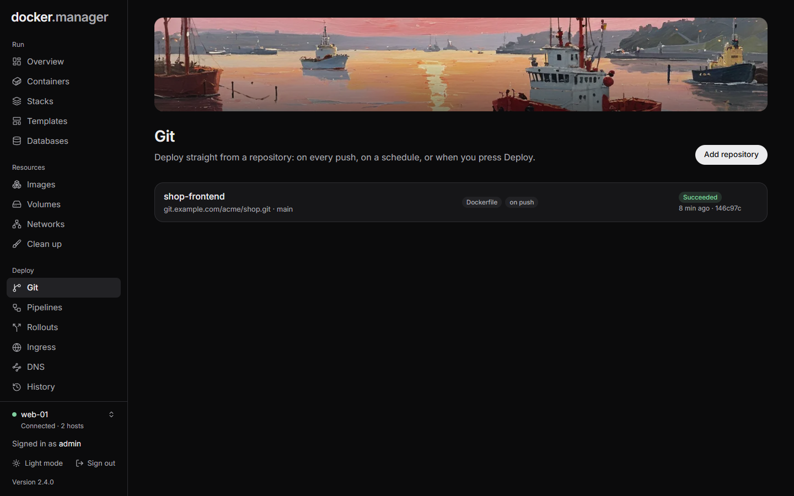
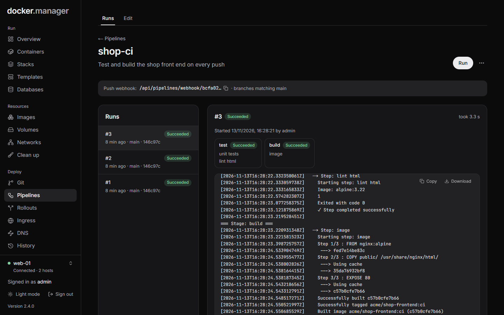

Docker Manager can deploy your own code, not just images someone else published. There are two ways:

- **Git** deploys a repository in one step: it builds the Dockerfile or runs the compose file, on every push, on a
  schedule, or when you press **Deploy now**. Start here.
- **Pipelines** run build and test steps first, in stages, each step in its own container. Use them when "build
  and run" isn't enough: unit tests, a build that produces a JAR, or a release through a
  [rollout](/docs/deploy/rollouts/) only after the tests pass.

Adding repositories and creating pipelines is for administrators. Other users can see and deploy them if their
[permissions](/docs/admin/users/) allow.

## Add a repository

Open **Git** and press **Add repository**.

**Repository**

- **Name**: shown in Docker Manager.
- **Docker host**: where it is built and deployed. It can't be changed later.
- **Repository URL**: `https://github.com/owner/repo.git` or `git@github.com:owner/repo.git`.
- **Branch**: the branch to deploy, `main` by default.

**Access**

- **Public**: no sign-in.
- **Access token**: a personal access token with read access to the repository. **Username** depends on the Git
  server: on GitHub your username; GitLab and most others accept anything (`oauth2` is used when it's empty);
  Bitbucket repository tokens use `x-token-auth`.
- **SSH key**: an unencrypted private key (`BEGIN OPENSSH PRIVATE KEY`). Add its public key to the repository as a
  read-only deploy key. The server's host key is trusted the first time and checked after that.

Tokens and keys are stored encrypted. When editing, leave them empty to keep the saved ones.

**How to deploy it**

- **Compose file**: the repository's compose file is deployed as a [stack](/docs/run/stacks/) named after the
  repository, and appears on the **Stacks** page. Leave **Compose file** empty to find it automatically
  (`compose.yaml`, `docker-compose.yml` and so on).
- **Dockerfile**: the image is built from the **Dockerfile** you name (the build context is the repository root)
  and tagged `:latest` and with the commit. Then, under **How to run it**:
  - **Replace the container**: the previous container is replaced. If the new one fails to start, the old one keeps
    running. Set its **Container name**, **Restart** policy, **Ports**, **Environment** and **Volumes** here.
  - **Release with a rollout**: each new image goes through a [rollout](/docs/deploy/rollouts/): it starts next to
    the current version, is tested, and gets visitors with blue/green or canary. Create the rollout on the
    **Rollouts** page first; its container settings are used.
  - **Only build the image**: the image is built and tagged, and nothing is started.

**Automatic deploys**

- **Deploy on push (webhook)**: works with GitHub, GitLab, Gitea and Forgejo. See [Webhooks](#webhooks) below.
- **Check for new commits regularly**: for servers that can't receive webhooks. Choose how often: every minute,
  5 minutes, 15 minutes or hour.

Press the button at the bottom to save. Nothing is deployed until you press **Deploy now** or a push arrives.

## Deploy and go back

On a repository's page:

- **Deploy now** deploys the newest commit of the branch.
- **Deploy a specific commit** takes a commit SHA on the branch, for example to go back to an earlier version.
- **Check for new commits** asks the Git server straight away. When the branch has moved on, the repository shows
  **new commits** on the Git page.

The **Deployments** tab lists each deployment with its commit, how it was started and its log, which you can follow
live while it runs.

## Webhooks

With **Deploy on push (webhook)** on, the repository's page shows a webhook URL once it's saved (administrators
can see and copy it). In your Git server's webhook settings:

1. Paste the URL. Use content type JSON and push events.
2. Also set the webhook's secret to the last part of the URL (after the final `/`): the **Secret** on GitHub,
   Gitea and Forgejo, the **Secret token** on GitLab. Signed requests are checked and deploy the exact commit that
   was pushed; unsigned ones deploy the branch's newest commit.

Keep the URL private: anyone who has it can start a deployment. Webhook URLs use the `BASE_URL` setting, so set it
to the address your Git server can reach (see [Environment variables](/docs/reference/environment/)).

## Pipelines

Open **Pipelines** and press **New pipeline**.

- **Repository**: checked out into `/workspace` before the first stage. **None** runs without a checkout.
- **Runs on**: the Docker host the steps run on.
- **Run on push**: gives you a webhook URL to add to the repository.
- **Check for new commits regularly** (with a repository): for servers that can't receive webhooks. Choose how
  often: every minute, 5 minutes, 15 minutes or hour.
- **Only for branches matching**: a regular expression the whole branch name must match, such as `main|release/.*`.

With **Check for new commits regularly** on, each check lists the repository's branches and starts a run for every
watched branch that has a new commit since its last run. Without a branch filter, only the repository's branch is
watched. A branch the pipeline has never run on is only noted the first time it's seen, so turning polling on
doesn't start a run for every existing branch: runs start with its next commit. A commit a webhook run has already
built isn't run twice. Polling needs a Git server that speaks the usual (smart) HTTP or SSH protocol, like GitHub,
GitLab, Gitea or Forgejo.

A pipeline is made of **stages**. In each stage, **Steps run** either **One after another** or **At the same time**.
A stage can wait for other stages to finish first, and **Stop the pipeline if it fails** decides whether a failed
step ends the run.

Every step runs in its own container with the workspace mounted at `/workspace`, so files one step writes are there
for the next. The kinds of step are:

| Kind | What it does |
| --- | --- |
| **Shell script** | Runs a script in a container (Alpine by default). |
| **Build image** | Builds a Dockerfile from the workspace and tags the image. |
| **Compose** | Runs `docker compose` with a file from the workspace (for example `up -d`). |
| **Any image** | Runs a command in an image of your choice, such as `node:22` for `npm test`. |
| **Java JAR** | Runs a JAR with Java 21. |
| **Release with a rollout** | Releases an image through a blue/green or canary [rollout](/docs/deploy/rollouts/) on the same host. |

Each step can also have a **Working directory** (relative to `/workspace`), a **Time limit (minutes)**, and **Carry
on if this step fails**.

**Release with a rollout** takes an image name that can use variables, such as `my-app:${GIT_COMMIT_SHORT}`. With
**Wait for the release to finish** on, the step fails if the release fails or is rolled back, so the pipeline's
result tells you whether the new version reached visitors.

### Variables in steps

Every step gets these environment variables:

| Variable | Value |
| --- | --- |
| `PIPELINE_ID`, `PIPELINE_NAME` | The pipeline |
| `BUILD_NUMBER`, `EXECUTION_ID` | This run |
| `GIT_REPO_URL`, `GIT_BRANCH` | The repository and branch, when the pipeline has one |
| `GIT_COMMIT`, `GIT_COMMIT_SHORT` | The commit being built, and its first 7 characters |
| `TRIGGER_TYPE`, `TRIGGERED_BY` | How the run was started, and by whom |

### Running a pipeline

Press **Run** on the pipeline's page. **Branch** and **Commit** are optional: by default the run uses the
repository's branch and its newest commit. The **Runs** list shows each run with its steps and their live output.
Runs also start from the push webhook, and from a rollout that uses the pipeline as a test.

**Turn off** stops a pipeline from running when triggered, **Duplicate** copies it, and **Delete** removes it.

:::tip
For one-click deploys from Git, the Git page is simpler. Reach for a pipeline when you need build or test steps
before deploying.
:::

## In the configuration file

Repositories and pipelines can also be described in the [configuration file](/docs/admin/configuration-as-code/),
under `gitRepositories` and `pipelines`. Applying the file never deploys or runs anything. See the
[reference](/docs/reference/configuration-file/#gitrepositories).
