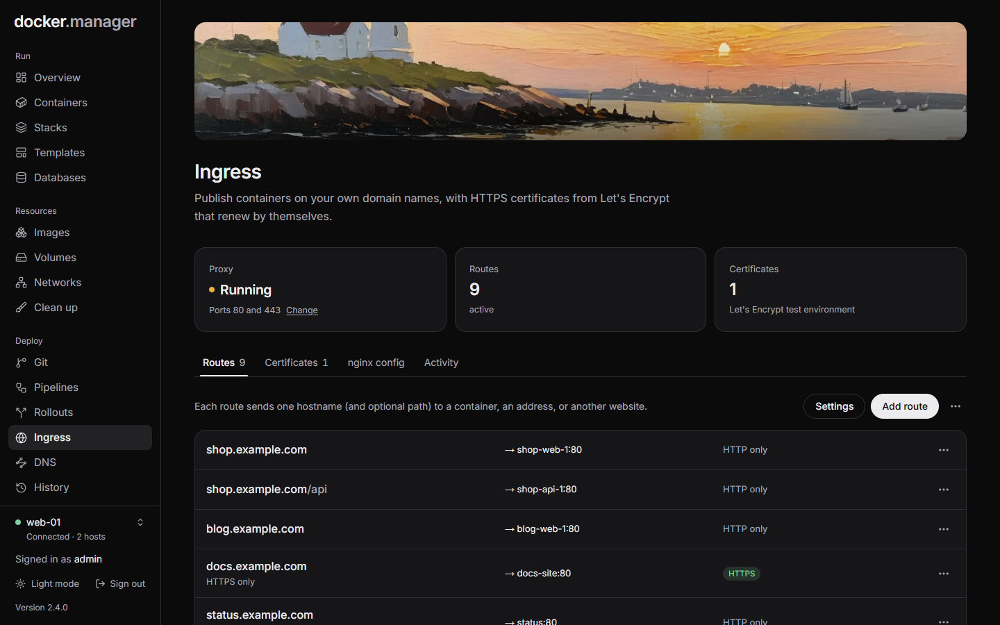

**Ingress** publishes containers on your own domain names. It runs an nginx proxy container on the host that receives
web traffic and sends each hostname to the container you choose, with HTTPS certificates from Let's Encrypt that
renew by themselves.

## Before you start

1. Point each domain's DNS (an A or AAAA record) at this server. If Docker Manager hosts the domain's
   [DNS](/docs/deploy/dns/), this happens by itself.
2. Open ports 80 and 443 in the firewall or router.
3. Stop anything else on this host that already uses those ports.

## Turn on ingress

Open **Ingress** and fill in:

- **HTTP port** and **HTTPS port**: 80 and 443 normally. Let's Encrypt connects on port 80, so use 80 for
  certificates (unless the domain's DNS is hosted here, see [Let's Encrypt over DNS](#lets-encrypt-over-dns)).
- **Email for Let's Encrypt**: Let's Encrypt writes to it if a certificate is about to expire.
- **Use Let's Encrypt's test environment**: for trying things out. No rate limits, but browsers don't trust the
  certificates.

Press **Turn on**. The proxy runs as a container on the host, and the containers your routes point at are connected
to its network automatically.

## Add a route

Each route sends one hostname (and optional path) to a container, an address, or another website. Press **Add
route** and choose what to **Send visitors to**:

- **A container**: choose or search for a container on this host, and its **Port**. Docker Manager suggests the
  ports the container exposes.
- **An address**: a host and port you type in, such as another machine on your network (`192.168.1.20` and `8080`).
- **Another website**: a redirect to a web address. **Keep the rest of the address** sends
  `old.example.com/page?x=1` to `https://example.org/page?x=1`; off, every page goes to the address itself.
  **Permanent redirect (301)** makes browsers and search engines remember it, so a later change reaches visitors
  slowly; off sends a temporary redirect (302).

Then:

- **Hostname**: such as `app.example.com`. Its DNS record must point at this server. A wildcard such as
  `*.example.com` works too, with a wildcard certificate when the domain's DNS is hosted here.
- **Path**: `/` for the whole site, or a path such as `/api` to send only that part.
- **HTTPS**: **Free certificate from Let's Encrypt**, **Upload my own certificate**, or **No HTTPS**.
- **Send visitors to HTTPS**: starts once the certificate is ready; until then the site answers over HTTP.
- **The container itself speaks HTTPS** (or **The address speaks HTTPS**): rare. Leave it off for most apps.

Routes can be edited, paused and resumed, and deleted from the list. Each one shows its state: **HTTPS**, **HTTP
only**, **Getting certificate**, **Certificate failed**, **paused**, **sign-in required**.

:::tip
Uploads through the proxy can be up to 1 GB per request. Long requests are allowed up to an hour, which suits
streaming and large downloads.
:::

## Require sign-in

Any route can ask visitors for a user name and password, so you can publish tools that have no login of their own.
Turn on **Require sign-in** and add the **People who can sign in**, each with a password of at least 8 characters.

Visitors see a sign-in page and stay signed in for 7 days. Scripts and API clients can send the same user name and
password as an `Authorization: Basic` header instead. Changing someone's password signs everyone out of that site.

These are per-route users, separate from Docker Manager's own accounts.

## Certificates

The **Certificates** tab lists every certificate with its state and expiry.

- **Let's Encrypt** certificates are requested when a route needs one and renewed automatically 30 days before they
  expire (the check runs daily). A failed renewal is retried at most twice a day. **Renew now** and **Try again** do
  it straight away; automatic renewal can be turned off per certificate.
- **Upload certificate** takes your own **Certificate (PEM)**, its **Private key (PEM)** (stored encrypted, and it
  must belong to the certificate) and any **Intermediate certificates**.

## Let's Encrypt over DNS

When Docker Manager hosts a domain's [DNS](/docs/deploy/dns/) and the registry points at it, certificates for its
hostnames are checked through DNS instead of port 80. Docker Manager publishes the `_acme-challenge` record itself
and removes it afterwards. Wildcard certificates are only issued this way.

## Settings and other tabs

- **Settings** changes the proxy's **Ports on this host** and the **Let's Encrypt** email and test environment. The
  proxy is restarted on the new ports, so routes are down for a few seconds. If a port is already in use, the proxy
  stays on the current ones.
- **nginx config** shows the configuration generated from your routes. It is tested with nginx before it is
  applied, and rewritten on every change, so edit routes instead.
- **Activity** lists what happened on this host's ingress: changes to routes and certificates, and proxy reloads.
- **Re-apply configuration** (in the menu) applies the configuration to the proxy again.
- **Turn ingress off** removes the proxy container, and every route stops answering. Routes and certificates are
  kept, so turning it back on restores them.

## What else uses ingress

[Rollouts](/docs/deploy/rollouts/), the [private registry](/docs/data/registry/) (served anywhere over HTTPS) and
[Grafana](/docs/watch/observability/) on a hostname all publish themselves through ingress, so it needs to be
turned on for them.

## In the configuration file

Ingress, its routes and uploaded certificates can be described under `ingress` in the
[configuration file](/docs/admin/configuration-as-code/). See the
[reference](/docs/reference/configuration-file/#ingress).
