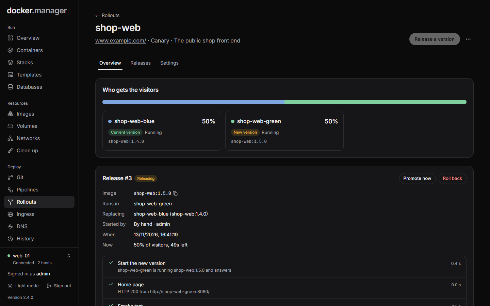
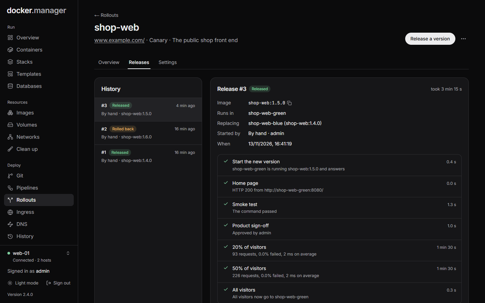

**Rollouts** release new versions of an app without downtime. Each new version starts next to the current one, is
tested, and only then gets visitors. If it misbehaves, visitors go back to the previous version automatically.

A rollout owns an address on [ingress](/docs/deploy/ingress/) and two containers, `NAME-blue` and `NAME-green`. One
serves visitors; each new version starts in the other one.



## Before you start

Rollouts need ingress turned on for the host. Creating, changing and deleting rollouts is for administrators;
releasing, approving, promoting and rolling back follow each user's [permissions](/docs/admin/users/).

## Create a rollout

Open **Rollouts** and press **New rollout**.

**Rollout**: a **Name**, the **Docker host** and an optional **Description**.

**How new versions reach visitors**: the **Strategy**.

- **Blue/green** moves all visitors at once, then watches the new version for a while with the old one still running.
- **Canary** moves a growing share of visitors at each step (for example 10%, 25%, 50%), then everyone.

**Address**: where visitors reach the app.

- **New address**: a **Hostname** (point its DNS at this server), a **Path**, and **HTTPS with a free Let's Encrypt
  certificate**. The route is created at the first release, once a tested version exists.
- **Take over an existing route**: choose a route that sends visitors to a container. Its container becomes the
  current version. The first release starts next to it, and the old container is stopped (not removed) once the new
  one serves everyone.
- **Preview address** (optional): always shows the version being released, so people can try it before approving.
  After a release it shows the current version.

**Container**: how each version runs.

- **Container name**: the base name; versions run as `NAME-blue` and `NAME-green`.
- **Port the app listens on**, **Restart**, **Environment** and **Volumes**. Both versions mount the same volumes
  while they run side by side.
- **Other networks**: the ingress network is always joined; add others to reach a database, for example. No ports
  are published on the server: visitors come in through the proxy.
- **Health path**: must answer with a status from 200 to 399 before the new version counts as up, and keeps being
  checked while it has visitors. **Time to start (seconds)** is how long it may take (180 by default).

## Tests before visitors see it

Tests run in order against the new version while visitors still use the current one. If one fails, the new version
is stopped and nothing changes for visitors. With no tests, only the health path is checked.

| Kind | What it does |
| --- | --- |
| **HTTP check** | Requests a page of the new version. Set the **Path**, **Expected status** (such as `200`, `2xx` or `200-299`; default 200-399, redirects are followed), **Page contains** and **Tries** (a few seconds apart, 3 by default). |
| **Command** | Runs a script with `/bin/sh` in any **Image** (such as `curlimages/curl:latest`). Exit code 0 passes. |
| **Pipeline** | Runs one of your [pipelines](/docs/deploy/git-pipelines/#pipelines). Its steps get `TARGET_URL` and join the network the new version is on. It must succeed. |
| **Approval** | Waits until someone presses **Approve** (or **Reject**). Add a preview address so they can look first. **Give up after (seconds)**: empty or 0 waits until someone decides. |

Command scripts can use `TARGET_URL`, `TARGET_HOST`, `TARGET_PORT`, `PUBLIC_HOSTNAME`, `RELEASE_IMAGE`,
`RELEASE_NUMBER` and `ROLLOUT_NAME`. For example:

```sh
curl -fsS "$TARGET_URL/api/health" | grep -q '"ok"'
```

## Moving visitors over

For **Canary**:

- **Share of visitors at each step (%)**: for example `10, 25, 50`, then everyone.
- **Length of each step (seconds)**.
- **Keep each visitor on one version**: chosen by address and browser, so a visitor doesn't flip between versions.
  Testers can set the cookie `dm_variant=canary` (or `stable`) to pick one.

For **Blue/green**, **Watch the new version for (seconds)** after the switch. The old version keeps running meanwhile;
0 skips watching.

## Automatic rollback

While the new version has visitors, the proxy logs which container answered each request. Every 10 seconds, the new
version's share of failed answers (status 500 or more), its average response time and its health path are checked.

With **Send visitors back to the current version when the new one misbehaves** on, visitors go back straight away
when a limit is crossed:

- **Most failed requests (%)**: 5 by default.
- **Slowest average answer (ms)**: empty for no limit.
- **Requests before judging**: fewer requests aren't enough to tell (20 by default).

When it's off, problems are logged and the release carries on (a crashed container still stops it).

**Keep the previous version running after a release** makes rolling back instant, at the cost of its memory.
Otherwise the previous version is stopped, and started again on roll back.

## Release a version

New versions can come from three places:

- **By hand**: press **Release a version** and enter an image, such as `ghcr.io/me/site:1.4.0`. It is pulled if it
  isn't on the host yet.
- **From Git**: in a Dockerfile repository's settings, choose **Release with a rollout** under **How to run it**, and
  pick this rollout. Each push builds the image and releases it. See [Git and pipelines](/docs/deploy/git-pipelines/).
- **From a pipeline**: add a **Release with a rollout** step after the step that builds the image. It can use
  variables such as `my-app:${GIT_COMMIT_SHORT}` and wait for the result.

A release goes like this:

1. The new version starts and must answer on its health path within the start time.
2. The tests run against it. If a test fails, the new version is stopped and nothing changes for visitors.
3. Visitors move over, all at once (blue/green) or step by step (canary).
4. The new version is watched. If a limit is crossed and automatic rollback is on, visitors go back to the previous
   version.

While a release runs, you can **Promote now** (canary) or **Finish now** (blue/green) to skip the remaining steps, or
**Stop** it. Once the new version has visitors, stopping is **Roll back**: visitors go back to the previous version.

The **Overview** tab shows **Who gets the visitors** and, during a release, charts of the new version's failed
requests and requests per 10 seconds. The **Releases** tab lists each release with its tests, traffic steps and logs.



## Roll back

After a release, **Roll back to** (the previous image) starts the previous version again and moves visitors back.

:::note
If Docker Manager restarts during a release, visitors are sent back to the previous version.
:::

## Deleting a rollout

**Delete rollout** removes the rollout, but the address keeps sending visitors to the current version as an ordinary
ingress route. The containers stay; remove the idle one on the **Containers** page if you no longer need it.

## In the configuration file

Rollouts can be described under `rollouts` in the [configuration file](/docs/admin/configuration-as-code/). Applying
the file never starts a release. See the [reference](/docs/reference/configuration-file/#rollouts).
