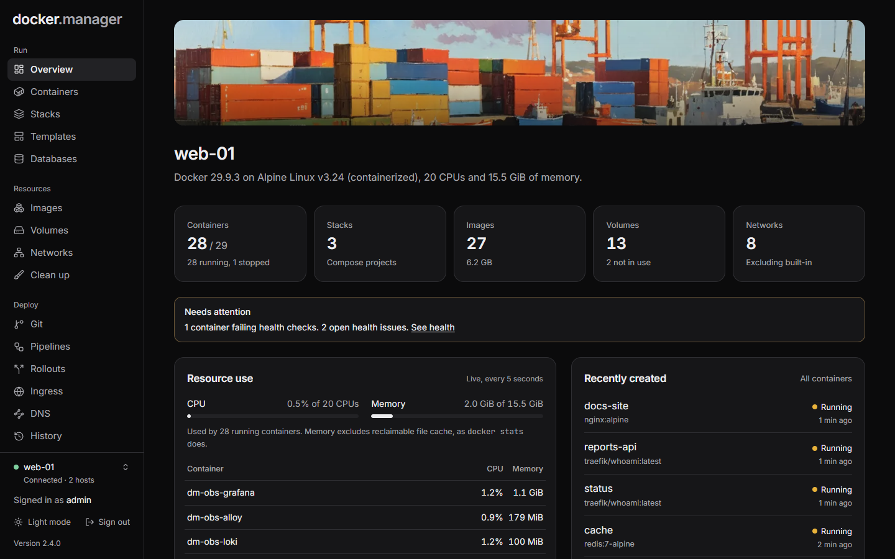

Docker Manager is a web interface for the Docker servers you run yourself. It runs as one container next to your
apps and gives you one place to start containers and Compose stacks, publish them on your own domains with HTTPS,
run PostgreSQL databases, watch logs and metrics, and keep everything secure.

It's free and open source (MIT licensed), with no subscriptions, licence fees or feature gates. It's built for
developers, homelab owners and small teams who want a complete tool without running a platform.

## What you can do with it

**Run**

- [Containers](/docs/run/containers/): start, stop, restart, read logs, run commands, watch CPU and memory, and
  change settings safely (the original is put back if the new container doesn't start).
- [Compose stacks](/docs/run/stacks/): create, edit and redeploy, with every deploy kept as a version you can go
  back to. Stacks started outside Docker Manager are found and can be imported without restarting anything.
- [Templates](/docs/run/templates/) for 53 popular apps, and [images, volumes and networks](/docs/run/images-volumes-networks/)
  with a file browser for volumes and a clean-up page.

**Deploy and publish**

- [Git repositories and pipelines](/docs/deploy/git-pipelines/) that build and deploy on push.
- [Rollouts](/docs/deploy/rollouts/): blue/green and canary releases with tests, live error-rate checks and
  automatic rollback.
- [Ingress](/docs/deploy/ingress/): your containers on your own domains, with Let's Encrypt certificates and
  optional sign-in pages.
- [DNS](/docs/deploy/dns/): host your domains' DNS on the server, like Route 53.

**Data**

- [PostgreSQL databases](/docs/data/databases/) with secure defaults, a SQL console, scheduled backups and copies to S3.
- A [private Docker registry](/docs/data/registry/).

**Watch and secure**

- [Health monitoring](/docs/watch/health/) with email alerts.
- [Observability](/docs/watch/observability/): Grafana, Prometheus, Mimir, Loki and Tempo, already connected.
- [Security scanning](/docs/watch/security/) with Trivy, Docker Scout and Docker Bench for Security, and
  [image rules](/docs/watch/policies/) that allow or block images.

**Administer**

- [Several Docker hosts](/docs/admin/hosts/) from one place: the local one, and remote ones over TLS or SSH.
- [Users, groups and per-host permissions](/docs/admin/users/), a [history of changes with undo, and an activity log](/docs/admin/history/).
- [Configuration as code](/docs/admin/configuration-as-code/): describe the whole setup in one YAML file and keep
  it in git.

## How it works

Docker Manager talks to Docker through its API. On the server it runs on, that's the Docker socket
(`/var/run/docker.sock`) mounted into its container; other servers are reached over TLS or SSH. Everything it
creates is an ordinary Docker container, network or volume, so `docker ps` and `docker compose` keep working as
usual, and you can stop using Docker Manager at any time without touching your apps.

Its own data (users, settings, history, database backups) lives in one SQLite database in a Docker volume.

## Get started

1. [Install it](/docs/start/install/) with a short compose file.
2. [Sign in and take a first look around](/docs/start/first-steps/).
3. Start something: a [template](/docs/run/templates/), a [container](/docs/run/containers/) or a
   [Compose stack](/docs/run/stacks/).
