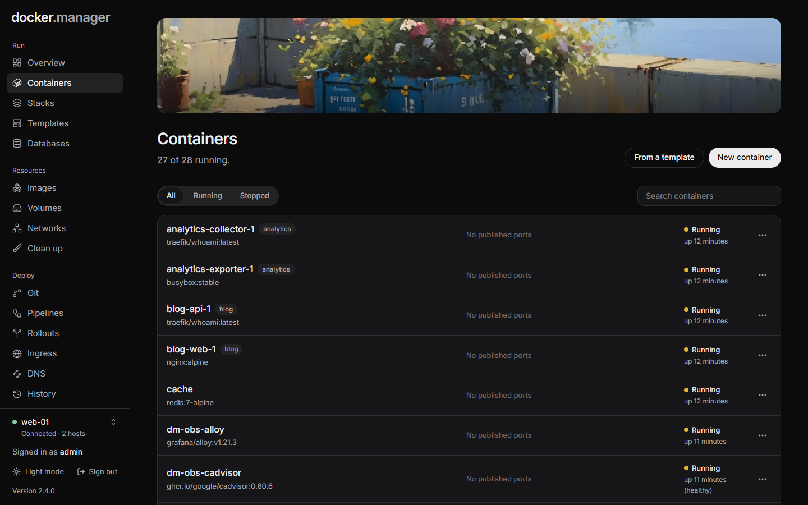
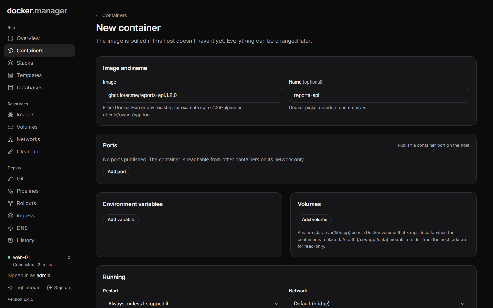
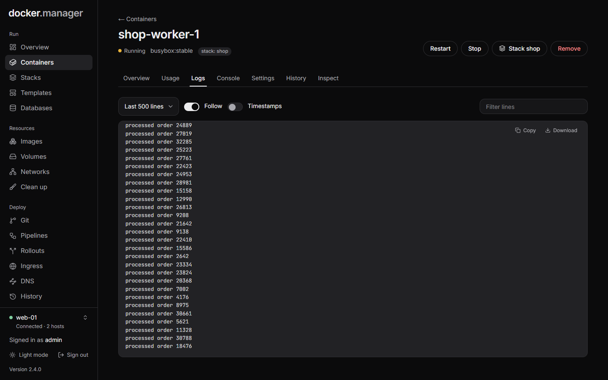

**Containers** lists everything on the selected host, running or stopped. Use **Show** to see all, running or
stopped containers, and the search box to find one by name.

Each row has a menu with **Start**, **Stop**, **Restart**, **Pause**, **Resume** and **Remove**, depending on its
state. Choose a container's name to open its page.

## Create a container

1. On **Containers**, choose **New container**. (Or start from a [template](/docs/run/templates/).)
2. Under **Image and name**:
   - **Image**: from Docker Hub or any registry, for example `nginx:1.29-alpine` or `ghcr.io/owner/app:tag`.
     Private images use the sign-ins saved under **Registries**.
   - **Name** (optional): Docker picks a random one if empty.
   - **Pull the newest version of the image first**: otherwise the image already on this host is used.
3. Under **Ports**, publish container ports on the host if you need to reach the app from outside. Without any,
   the container is only reachable from other containers on its network. To put an app on a domain with HTTPS
   instead, use [Ingress](/docs/deploy/ingress/).
4. Add **Environment variables** (`NAME=value`) and **Volumes**:
   - A name, like `data:/var/lib/app`, uses a Docker volume that keeps its data when the container is replaced.
   - A path, like `/srv/app:/data`, mounts a folder from the host; add `:ro` for read-only. Only administrators
     can mount host folders.
5. Under **Running**, choose the **Restart** policy (**Always, unless I stopped it**, **Always**, **Only after a
   crash** or **Never**), the **Network**, and whether to **Start it right away**.
6. **Advanced** has the command, the user to run as, memory and CPU limits, the working directory, extra
   capabilities, and **Privileged** (full access to the host; only for software that needs it).
7. Choose **Create container**. The image is pulled if the host doesn't have it yet.

## A container's page

The page header shows the container's state, its image and, if it belongs to one, its stack. The buttons change
with its state: **Start**, **Stop**, **Restart** or **Resume**, plus **Update image** and **Remove**.

The tabs:

| Tab | What it shows |
| --- | --- |
| **Overview** | Image, created and started times, restart policy and count, command, stack, health, published ports, volumes and mounts, and environment variables (hidden until you choose **Show values**). |
| **Usage** | CPU (% of one core), memory, network traffic and processes, sampled every 3 seconds while the page is open. |
| **Logs** | The last 100, 500, 2,000 or 10,000 lines, with **Follow**, **Timestamps** and a filter. |
| **Console** | Runs commands inside the running container. |
| **Settings** | The same form as when creating it, to change any setting. |
| **History** | Changes made to this container through Docker Manager, with **Undo**. |
| **Inspect** | Docker's full description of the container. |

If the container's last run was stopped because it ran out of memory, the page tells you, so you can raise its
memory limit.

### Run a command

The **Console** tab runs one command at a time inside the container. It runs without a shell, so pipes and `&&`
aren't available. Use the up and down arrow keys to go back through earlier commands. Every command is recorded in
the [activity log](/docs/admin/history/#activity).

### Change settings safely

To change a container's settings, open **Settings**, make your changes and choose **Save and recreate**. Docker
can't change most settings of an existing container, so Docker Manager creates a new one with the new settings and
the same volumes. If the new container doesn't start, the original is put back. Every change is recorded in
[History](/docs/admin/history/), where you can undo it.

### Update to a newer image

**Update image** pulls the newest version of the container's image (for example a new `:latest`) and replaces the
container with one using it. Settings and volumes stay the same, and if the new one fails to start, the current one
keeps running.

Containers that belong to a stack don't have this button: update them from the stack with **Pull newest images and
redeploy**. See [Compose stacks](/docs/run/stacks/).

### Remove a container

**Remove** stops and deletes the container. Named volumes and their data are kept. If the container belongs to a
stack, the stack recreates it on its next deploy.

:::note
Docker Manager's own container is protected: it won't stop, remove or replace itself, and only administrators can
see its logs and settings (its log contains the first administrator's temporary password).
:::
