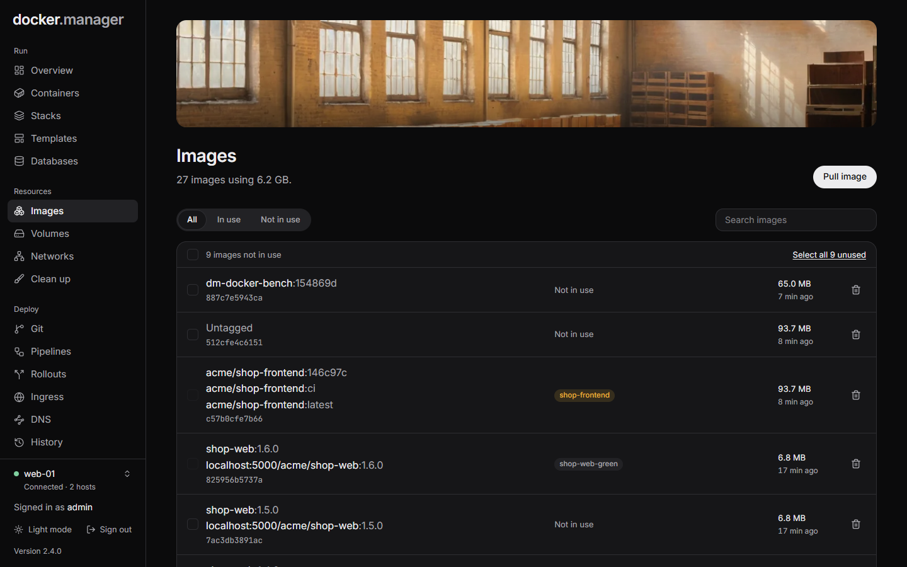
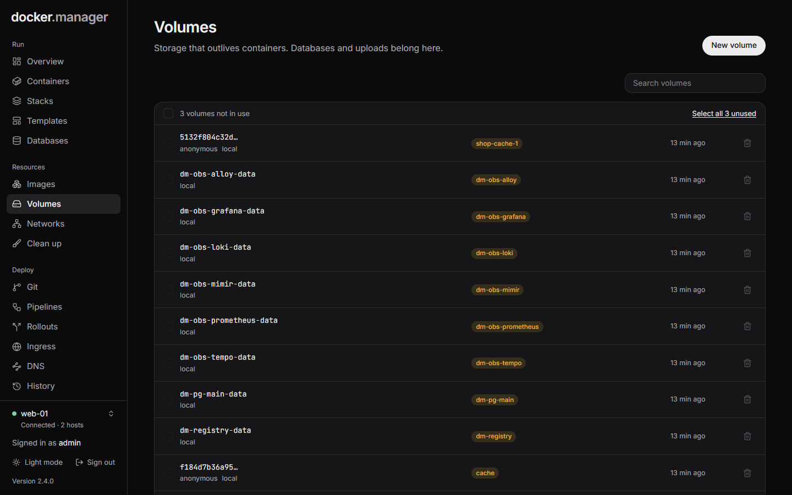
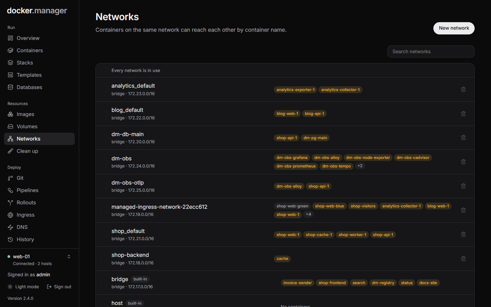
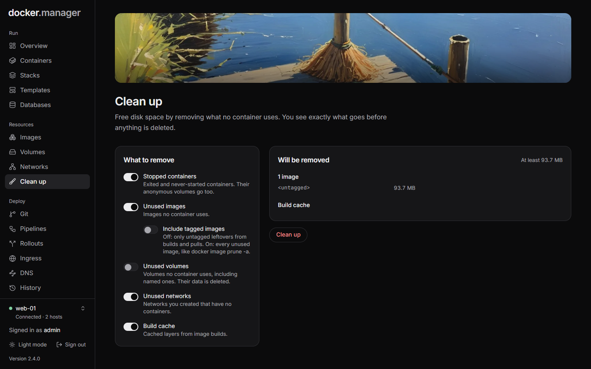

The **Resources** group in the sidebar has the building blocks behind your containers: **Images**, **Volumes**,
**Networks** and **Clean up**.

## Images

**Images** lists the images on the selected host: the templates containers are created from. Use **Show** to see
**All**, **In use** or **Not in use**, and search by name.

**To pull an image:** choose **Pull image**, enter its name (for example `nginx:1.29-alpine`) and choose **Pull**.
Saved sign-ins from **Registries** are used for private images. Large images can take a few minutes.

**To delete images:** use **Delete image** on one, or select several and delete them together. **Select all ...
unused** picks every image no container uses. An image that a container uses can't be deleted; remove those
containers first. Deleted images can be pulled again later.

## Volumes

**Volumes** are storage that outlives containers: databases and uploads belong here. Each volume shows whether a
container uses it.

- **New volume** creates an empty volume. Containers also create volumes when they ask for them.
- **Delete volume** deletes a volume and everything stored in it. This can't be undone. Select several, or **Select
  all ... unused**, to delete them together.

### Browse a volume's files

Administrators can choose **Browse files** on a volume to look inside it. (Browsing is for administrators only,
because volumes hold every app's data, including passwords and databases.)

The browser opens **Read-only**. You can move through folders, filter the current folder, open text files (the
first 512 KB are shown), download a file, and download a folder or the whole volume as a `.tar` file.

To change files, choose **Read-only** and confirm **Allow changes**. The button turns into **Changes on**, and you
can **Upload** files (up to 100 MB each), create a **New folder** and delete files and folders. Apps using the
volume see changes straight away, and deleted files can't be brought back.

:::note
Folders with more than 5,000 entries show only the first 5,000.
:::

## Networks

**Networks** lists the Docker networks on the host. Containers on the same network can reach each other by
container name. Docker's own networks are marked **built-in**.

- **New network** creates a bridge network. Attach containers to it in their settings (the **Network** field on a
  [container's settings](/docs/run/containers/#create-a-container)).
- **Delete network** deletes a network. Built-in networks, and networks with containers connected, can't be
  deleted. **Select all ... unused** picks every network without containers.

Some features create their own networks, for example [Ingress](/docs/deploy/ingress/) (`managed-ingress-network-*`),
[Databases](/docs/data/databases/) (`dm-db-*`) and [Observability](/docs/watch/observability/) (`dm-obs-*`).

## Clean up

**Clean up** (administrators only) frees disk space by removing what no container uses. You see exactly what goes
before anything is deleted.

1. Under **What to remove**, choose what to include:

   | Choice | What it removes |
   | --- | --- |
   | **Stopped containers** | Exited and never-started containers. Their anonymous volumes go too. |
   | **Unused images** | Images no container uses. With **Include tagged images** off, only untagged leftovers from builds and pulls; on, every unused image, like `docker image prune -a`. |
   | **Unused volumes** | Volumes no container uses, including named ones. Their data is deleted. |
   | **Unused networks** | Networks you created that have no containers. |
   | **Build cache** | Cached layers from image builds. |

2. Check the list under **Will be removed**, which also shows at least how much space it frees.
3. Choose **Clean up** and confirm.

:::caution
**Unused volumes** includes named volumes that no container uses right now, for example the data of an app you've
stopped and removed but plan to start again. Check the list before you confirm.
:::

The [overview](/docs/start/first-steps/#the-overview) tells administrators when stopped containers, untagged images
or unused volumes are taking up space, with a link to this page.
