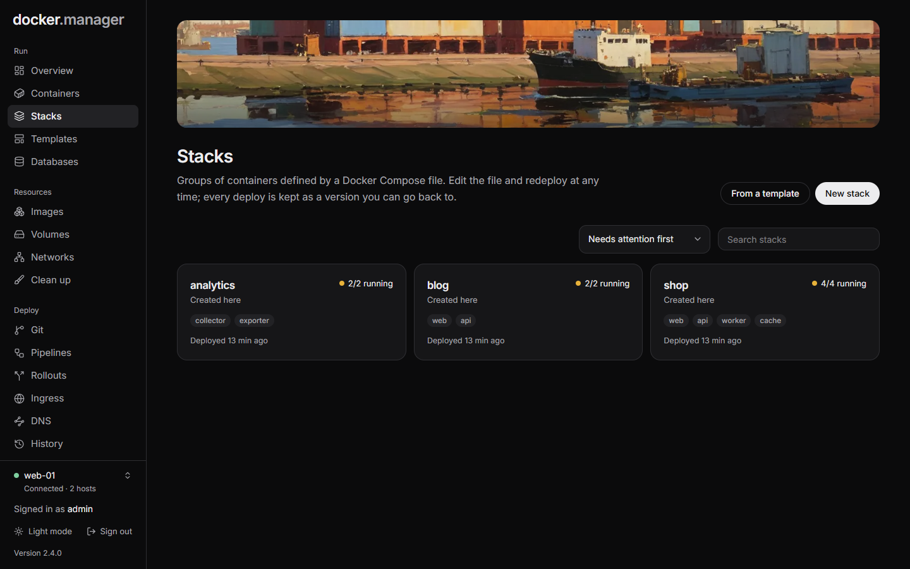
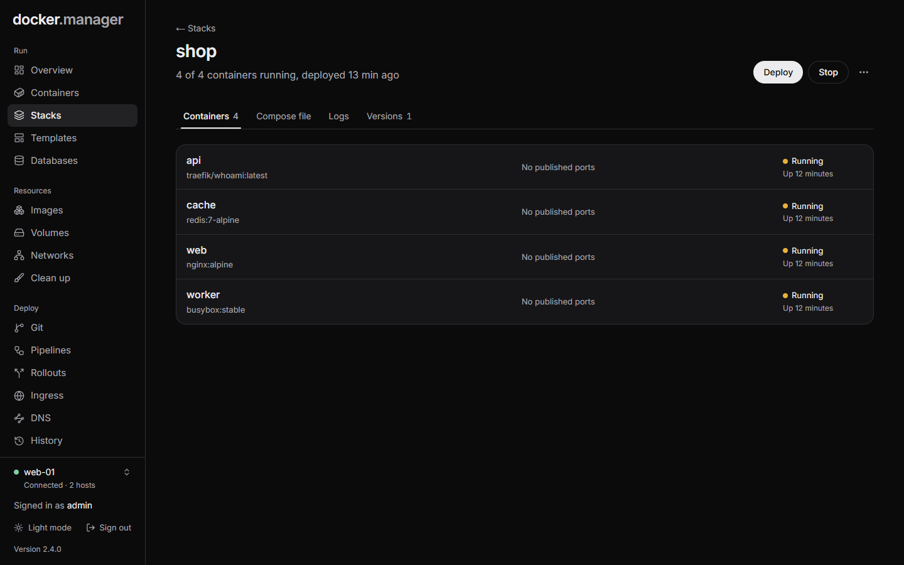

A **stack** is a group of containers defined by a Docker Compose file: the containers, networks and volumes that
run together. Edit the file and redeploy at any time; every deploy is kept as a version you can go back to.

Each stack shows where it came from (**Created here**, **From a template**, **From git** or **Imported**), how many
of its containers are running, and when it was last deployed. Use the sort menu to see **Needs attention first**,
**Recently deployed** and more.

:::note
Compose files can give containers access to the host, so only administrators create stacks and edit their files.
Other users with permission can deploy, start and stop them.
:::

## Create a stack

1. On **Stacks**, choose **New stack**. (Or **From a template** for apps like WordPress or Pi-hole.)
2. Give it a **Name**: lowercase letters, digits, `-` and `_`. It's also the Compose project name, so containers
   are called `name-service-1`.
3. Paste or write the compose file under **docker-compose.yml**.
4. Put variables used as `${NAME}` in the compose file under **.env**, for example
   `POSTGRES_PASSWORD=choose-a-strong-one`.
5. Choose **Check file** to validate it, then **Create and deploy**. Or **Save without deploying** to deploy later.

Each stack's `compose.yaml` and `.env` are stored in their own folder under the stacks folder
(`/opt/docker-manager/stacks` by default); the **Compose file** tab shows where. Relative paths in the file, like
`./data`, are relative to that folder. See [Install](/docs/start/install/#why-the-stack-and-git-folders-use-the-same-path-on-both-sides) for why
that folder must have the same path on the host.

## A stack's page

The buttons at the top:

- **Deploy** runs `docker compose up` with the saved file. (A stack from git has **Deploy from git** instead,
  which opens its [repository](/docs/deploy/git-pipelines/).)
- **Start** and **Stop** start or stop its containers.
- The menu has **Pull newest images and redeploy**, **Restart**, **Take down**, **Remove stack** and **Remove
  stack and its volumes**.

| Action | What happens |
| --- | --- |
| **Take down** | Stops and deletes the containers and networks. The compose file is kept, so you can deploy again. |
| **Remove stack** | Stops and deletes the containers and networks and forgets the stack. Volumes and their data are kept. |
| **Remove stack and its volumes** | Also deletes the stack's volumes with all their data. This can't be undone. |

While an action runs, its output is shown live. If the last action failed, the page shows its error.

The tabs:

- **Containers**: the stack's containers and their published ports.
- **Compose file**: edit the compose file and `.env`, then **Save and deploy**, or **Save only**. With no changes,
  the first button is **Redeploy**. **Check file** validates the file, and **Discard changes** puts back the saved
  version. A stack from git shows its file read-only: change it in the repository and deploy the repository.
- **Logs**: the last 100, 300 or 2,000 lines of each container.
- **Versions**: every deploy.

## Go back to an earlier version

Every deploy saves the compose file and `.env` as a version. To go back:

1. Open the stack and choose **Versions**.
2. Find the version you want and choose **Roll back**.

Its compose file and `.env` replace the current ones, and the stack is redeployed. The newest 50 versions of each
stack are kept.

## Stacks started elsewhere

Docker Manager finds Compose projects started outside it (with `docker compose up` on the server, or by another
tool) and lists them as **Not managed here**. You can see their containers, but to edit and redeploy them, import
their compose file:

- On the stack's page, choose **Find the compose file**. Docker Manager reads the file from where the project was
  started, along with its `.env` file (or one rebuilt from the running containers), and shows what it found before
  importing.
- On **Stacks**, **Import ... unmanaged** imports every one whose compose file can be found.

Importing never restarts anything. Imported stacks keep running from their original folder, so relative paths
still point at the same data, and an imported stack deploys without removing services it doesn't know about.

## Docker Manager's own stack

If Docker Manager itself runs from a compose file, its stack is shown with the notice **This is Docker Manager
itself**, and deploying, stopping and restarting it are turned off. Doing those from inside would take it offline
halfway through. Update it on the server with `docker compose pull && docker compose up -d`.
