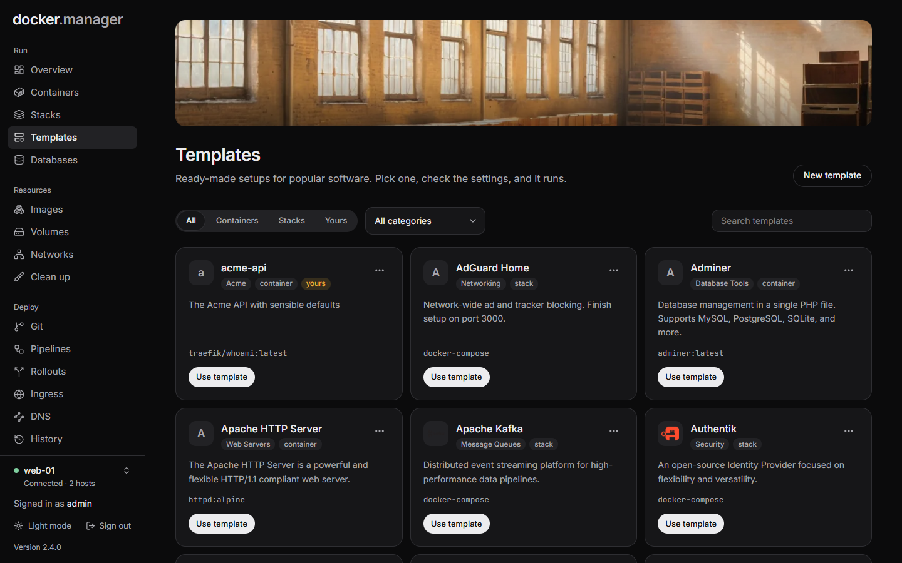

**Templates** are ready-made setups for popular software. Pick one, check the settings, and it runs.

Docker Manager comes with 53 templates in 15 categories, including:

- **Databases:** PostgreSQL, MySQL, MariaDB, MongoDB, Redis, InfluxDB
- **Web servers:** Nginx, Apache HTTP Server, Caddy, Traefik, Nginx Proxy Manager
- **Monitoring:** Grafana, Prometheus, Uptime Kuma, cAdvisor, Dozzle, Netdata
- **Development and automation:** Gitea, GitLab CE, Jenkins, Code Server, n8n, Node-RED
- **Home and media:** Home Assistant, Jellyfin, Plex, Nextcloud, FileBrowser
- **Security and networking:** Vaultwarden, Authentik, WireGuard, Pi-hole, AdGuard Home, Cloudflare Tunnel
- **And more:** RabbitMQ, Apache Kafka, NATS, Elasticsearch, Meilisearch, Adminer, pgAdmin, phpMyAdmin, WordPress,
  Ghost, Watchtower, Diun, Mailpit

Most are single containers. Nine are Compose stacks (Authentik, WireGuard, Pi-hole, AdGuard Home, Cloudflare
Tunnel, Apache Kafka, Mongo Express, WordPress and Watchtower).

## Use a template

1. Open **Templates**. Narrow the list with **Type** (**All**, **Containers**, **Stacks** or **Yours**), a category,
   or the search box.
2. Choose **Use template** on the one you want.
3. You get the [new container](/docs/run/containers/#create-a-container) or
   [new stack](/docs/run/stacks/#create-a-stack) form, filled in. Replace any placeholder values, like passwords;
   for container templates that have them, the page reminds you.
4. Check the settings and create it.

A template's menu also links to the software's **Documentation**, when it has some.

:::note
Stacks are created by administrators, so other users only see **Use template** on container templates.
:::

## Make your own

To save a setup you use often:

1. Choose **New template**, or **Duplicate** on an existing one to start from it.
2. Give it a **Name** and **Description**, and choose **Single container** or **Compose stack**.
3. For a container, fill in the **Image**, and optionally **Ports** (`8080:80,53:53/udp`), **Environment**
   (`NAME=value`, comma separated) and **Volumes** (`data:/data`). For a stack, paste the **Compose file**.

Your templates are marked **yours** and can be edited and deleted from their menu. The built-in ones can only be
duplicated.

Templates can also be defined in the [configuration file](/docs/admin/configuration-as-code/).
