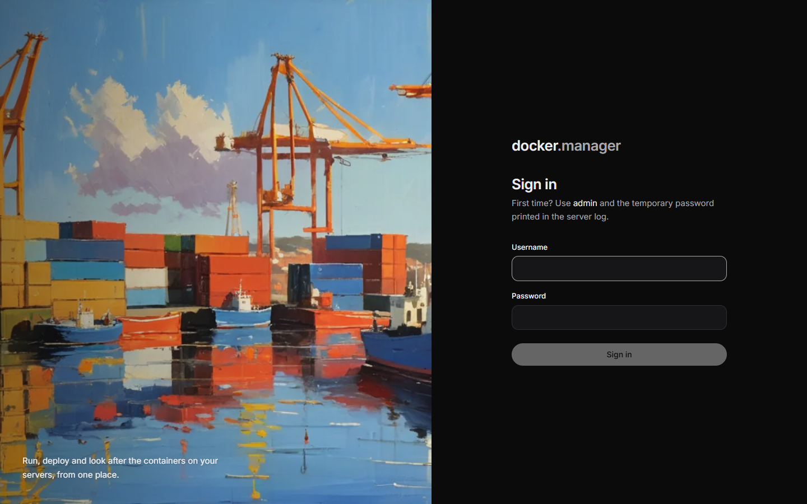
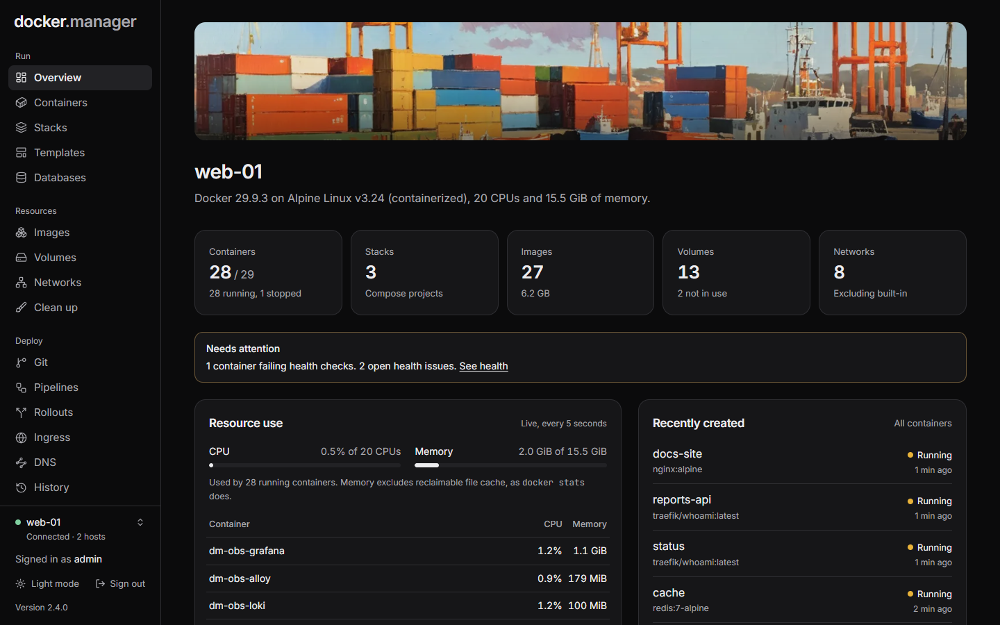

## Sign in for the first time

The first user is called `admin`. Its temporary password is printed in the container's log on first start:

```bash
docker logs docker-manager
```

Look for the lines that say `INITIAL ADMIN ACCOUNT CREATED`:

```
========================================
INITIAL ADMIN ACCOUNT CREATED
========================================
Username: admin
Temporary Password: ...
```

1. Open Docker Manager in your browser (port 8080 unless you changed it).
2. Enter `admin` and the temporary password, and choose **Sign in**.
3. On **Choose your password**, enter the temporary password again, then your own password twice (at least 8
   characters; a passphrase of a few words is easy to remember and hard to guess).
4. Choose **Set password and continue**.



:::note
Signing in is rate limited. After several wrong passwords, more attempts are refused for a while, and the wait
doubles with each further failure (up to 15 minutes).
:::

## Find your way around

The sidebar groups everything into five areas:

| Group | Pages |
| --- | --- |
| **Run** | Overview, Containers, Stacks, Templates, Databases |
| **Resources** | Images, Volumes, Networks, Clean up |
| **Deploy** | Git, Pipelines, Rollouts, Ingress, DNS, History |
| **Watch** | Health, Observability, Security, Activity |
| **Setup** | Hosts, Registries, Image rules, Users, Settings, Configuration |

Some pages are only shown to administrators: Databases, Clean up, DNS, Observability, Security, Activity, Users and
Configuration.

At the bottom of the sidebar you'll find the selected Docker host, a light and dark mode switch, your account, and
the version of Docker Manager you're running.

### The overview

**Overview** shows the selected host at a glance: its Docker version, operating system, CPUs and memory; how many
containers, stacks, images, volumes and networks it has; live CPU and memory use (updated every 5 seconds) with the
busiest containers; and the most recently created containers. If containers are failing their health checks, a
**Needs attention** notice links to [Health](/docs/watch/health/).



### Switching hosts

Docker Manager can look after several Docker servers. Most pages show the host selected at the bottom of the
sidebar; pick another one there to switch. [Hosts](/docs/admin/hosts/) explains how to add remote servers.

## Your account

Choose your name at the bottom of the sidebar to open **Your account**:

- **Password**: change your password. Your other sessions are signed out when you do.
- **Sessions**: **Sign out everywhere** signs you out on every browser and device, including this one. Use it if
  you signed in somewhere you don't trust.

## What to do next

- Start an app from a [template](/docs/run/templates/), or create a [container](/docs/run/containers/) or a
  [Compose stack](/docs/run/stacks/).
- [Add other people](/docs/admin/users/) and give them only the access they need.
- [Set up email](/docs/admin/settings/) so Docker Manager can tell you when something goes wrong.
- Publish an app on your own domain with [Ingress](/docs/deploy/ingress/).
