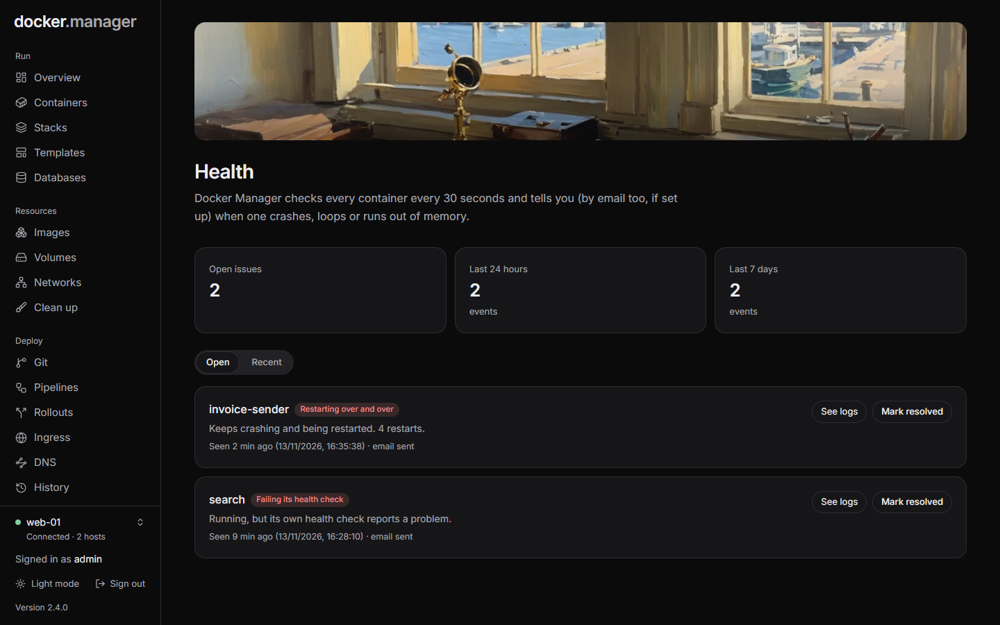

Docker Manager checks every container on every host every 30 seconds. When something goes wrong, it shows up on the
**Health** page, and administrators get an email once an [email server](/docs/admin/settings/) is set up.

## What it watches for

| Problem | What it means |
| --- | --- |
| **Crashed** | Stopped with an error while it was running. |
| **Restarting over and over** | Keeps crashing and being restarted: 3 restarts within 5 minutes. |
| **Failing its health check** | Running, but its own health check (the image's or compose file's `HEALTHCHECK`) reports a problem. |
| **Ran out of memory** | Stopped by the kernel because it used more memory than allowed. |

## The Health page

The page shows the number of **Open issues**, and the events of the **Last 24 hours** and **Last 7 days**, for the
selected host.

- **Open** lists the problems that still need attention. **See logs** opens the container's logs, and **Mark
  resolved** clears an issue once you've dealt with it.
- **Recent** lists everything that happened lately, including resolved issues.

When every container is fine, the page says **All healthy**.

## Email alerts

Each problem is emailed to administrators who have an email address. A container is reported at most once an hour
for the same kind of problem, so one that keeps failing doesn't flood your inbox. Every event is still recorded on
the Health page.

Each person chooses which emails they get under **Settings**, **Your notifications**: for example **Container Stopped
Unexpectedly**, **Container Restart Loop**, **Container OOM Killed** and **Container Health Check Failed**. See
[Settings](/docs/admin/settings/).

## Live CPU and memory

For a closer look at one container, open it on the **Containers** page and choose the **Usage** tab: live charts of
its CPU (as a share of one core), memory and network traffic, measured while it runs. See
[Containers](/docs/run/containers/).

For history over days or weeks, every container's logs, and host metrics, turn on
[Observability](/docs/watch/observability/).

:::tip
Add a `HEALTHCHECK` to your images or a `healthcheck:` to your compose services. Docker then knows when an app is
running but not answering, and Docker Manager can tell you.
:::
