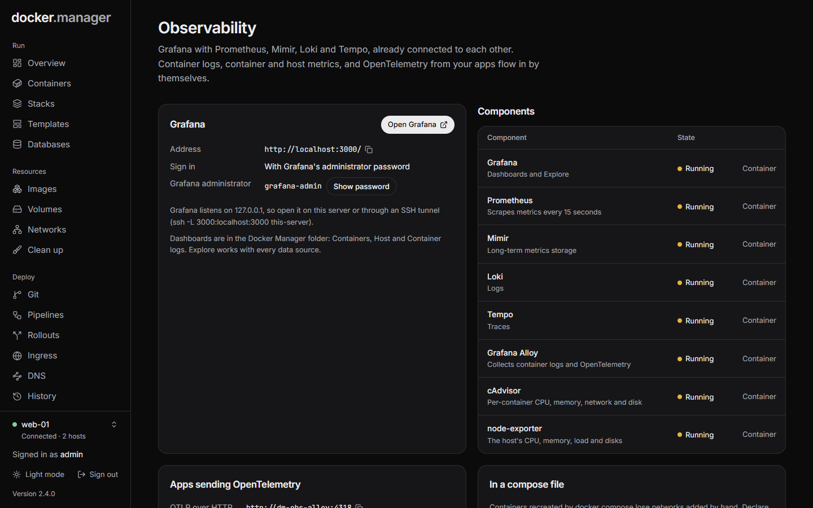

**Observability** runs Grafana with Prometheus, Mimir, Loki and Tempo on a host, already connected to each other.
Every container's logs, container and host metrics, and OpenTelemetry from your apps flow in by themselves, so you
get dashboards, log search and traces without wiring anything up.

Observability is for administrators, because Grafana shows every container's logs and metrics.



## What's in the stack

One stack runs per host:

| Component | Image | Role |
| --- | --- | --- |
| Grafana | `grafana/grafana:13.3.1` | Dashboards and Explore, with every data source set up |
| Prometheus | `prom/prometheus:v3.16.0` | Scrapes metrics every 15 seconds |
| Mimir | `grafana/mimir:3.2.4` | Long-term metrics: Prometheus writes everything into it (optional) |
| Loki | `grafana/loki:3.7.9` | Logs (optional) |
| Tempo | `grafana/tempo:3.1.1` | Traces, service graphs and span metrics (optional) |
| Grafana Alloy | `grafana/alloy:v1.21.3` | Collects container logs, and receives OpenTelemetry from apps |
| cAdvisor | `ghcr.io/google/cadvisor:0.60.6` | Per-container CPU, memory, network and disk |
| node-exporter | `prom/node-exporter:v1.12.1` | The host's CPU, memory, load and disks |

Everything runs in containers named `dm-obs-*`, on their own network, with data in `dm-obs-*` volumes. Only Grafana
is reachable from outside. Each piece runs in single-server mode, which suits one host's logs, metrics and traces
rather than a large fleet.

## Start the stack

Open **Observability** and choose:

**Reach Grafana**

- **On a hostname, over HTTPS**: through [ingress](/docs/deploy/ingress/), with a Let's Encrypt certificate. Point the
  hostname's DNS at this server first, and turn ingress on for the host. Administrators sign in with their Docker
  Manager account.
- **On a port on this server**: published on `127.0.0.1` only. Sign in with Grafana's own administrator password,
  shown on the page once it runs. Open it on the server, or through an SSH tunnel
  (`ssh -L 3000:localhost:3000 your-server`).

**Components**: Grafana and Prometheus are always on. **Mimir** keeps the long history (without it, Prometheus keeps
it), **Loki** stores logs, and **Tempo** stores traces.

**Collect**

- **Every container's logs**: Grafana Alloy reads them from Docker and labels them with the container and Compose
  service. Needs Loki.
- **Container and host metrics**: cAdvisor for each container's CPU, memory, network and disk; node-exporter for the
  host.
- **OpenTelemetry from your apps**: apps you connect send traces, metrics and logs to Grafana Alloy, which passes them
  on.

**Keep data for**: days of metrics (30 by default), logs (14) and traces (7).

Press **Start the stack**. The first start downloads the images, about 4 GB on disk once unpacked, which can take a
few minutes. The page updates by itself.

## Using Grafana

Press **Open Grafana**. Grafana comes with three dashboards in a **Docker Manager** folder: **Containers**, **Host**
and **Container logs**. **Explore** works with every data source. Trace ids in logs link to Tempo, and traces link
back to their logs.

**Signing in with a hostname.** Docker Manager administrators sign in to Grafana with their own account. Docker Manager
signs a short-lived token, the ingress proxy keeps it in a cookie and passes it to Grafana, and Grafana checks it with
the public key Docker Manager gave it, so nothing else can sign anyone in. Other users can't open Grafana.

Grafana's own administrator account (**Show password** on the page) works on the port, or on the hostname at
`/login?local`, for when Docker Manager isn't reachable.

## Send data from your apps

Apps that use the OpenTelemetry SDK can send traces, metrics and logs:

1. Connect the container to the stack with **Connect a container** on the page. Connected containers reach Grafana
   Alloy on the `dm-obs-otlp` network, and nothing else of the stack.
2. Point the SDK at `http://dm-obs-alloy:4318` (HTTP), or `dm-obs-alloy:4317` for gRPC.

Alloy sends traces to Tempo, logs to Loki and metrics to Mimir (or Prometheus without Mimir).

Containers that docker compose re-creates lose networks added by hand, so for a stack, declare the network in its
compose file instead. The page shows the lines to add, along these lines:

```yaml
services:
  app:
    environment:
      OTEL_EXPORTER_OTLP_ENDPOINT: http://dm-obs-alloy:4318
      OTEL_SERVICE_NAME: my-app
    networks: [default, dm-obs-otlp]

networks:
  dm-obs-otlp:
    external: true
```

## Change or remove it

Components, collectors and retention can be changed at any time under **Settings**: press **Apply changes**, and only
the containers whose settings change are recreated. Turning a component off keeps its data.

**Remove stack** removes the containers. The collected data is kept in its volumes unless you tick **Also delete the
collected data** (which also deletes the dashboards you made in Grafana).

## In the configuration file

The stack can be described under `observability`, keyed by host, in the
[configuration file](/docs/admin/configuration-as-code/). See the
[reference](/docs/reference/configuration-file/#observability).
