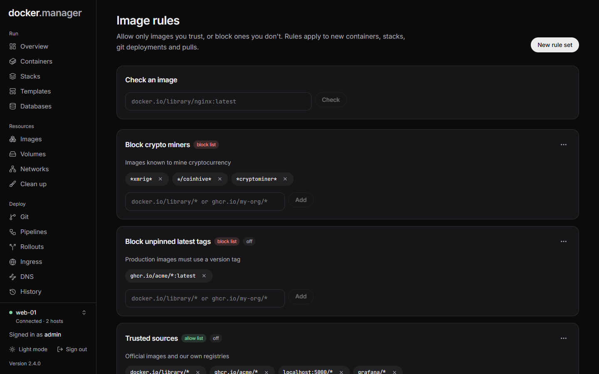

**Image rules** decide which images may be used. Allow only images you trust, or block ones you don't. Rules apply to
new containers, stacks, git deployments and pulls.

## How rules decide

Rules are grouped in **rule sets** of two kinds:

- **Allow list**: only images matching one of its patterns may be used.
- **Block list**: images matching one of its patterns are refused.

An image is checked like this:

1. If it matches a pattern in any block list that is on, it is **Blocked**.
2. If there are no allow lists, every other image is **Allowed**.
3. If there are allow lists, the image must match a pattern in one of them, or it is **Blocked**.

With no rules at all, every image is allowed.

## Create a rule set

Press **New rule set** and choose:

- **Kind**: **Allow list** or **Block list**.
- **Name** and **Description**: for example "Official images only".
- **Turn on now**: rule sets can also be turned on and off later.

Then add patterns to it, such as `docker.io/library/*` or `ghcr.io/my-org/*`.

## Patterns

Patterns are written the way you write image names:

- `*` matches any run of characters, `?` one character. Case doesn't matter.
- Images and patterns from Docker Hub are read in full: `nginx` means `docker.io/library/nginx`, and `bitnami/*`
  means `docker.io/bitnami/*`. So `nginx`, `docker.io/nginx` and `index.docker.io/library/nginx` are the same image.
- A pattern without a tag matches every tag of that image: `nginx` matches `nginx:1.27` and `nginx:latest`. Add a tag
  to match only that one, such as `nginx:1.27`.
- A name whose first part has a dot, a colon or is `localhost` is a registry: `ghcr.io/acme/*`,
  `registry.example.com:5000/*`, `localhost/*`.
- A pattern starting with `*` or `?` is used exactly as written, matching the full name, such as
  `*/library/nginx*`.

| Pattern | Matches |
| --- | --- |
| `docker.io/library/*` | Every official Docker Hub image (`nginx`, `postgres:18`, `redis:alpine`) |
| `ghcr.io/acme/*` | Every image under `ghcr.io/acme/` |
| `postgres` | `postgres` with any tag |
| `*:latest` | Any image tagged `latest` |

## Check an image

**Check an image** at the top of the page tells you whether an image would be allowed, and which rule set decided.
Use it to test a new rule before you rely on it.

## In the configuration file

Rule sets can be described under `imagePolicies` in the [configuration file](/docs/admin/configuration-as-code/). See
the [reference](/docs/reference/configuration-file/#imagepolicies).
