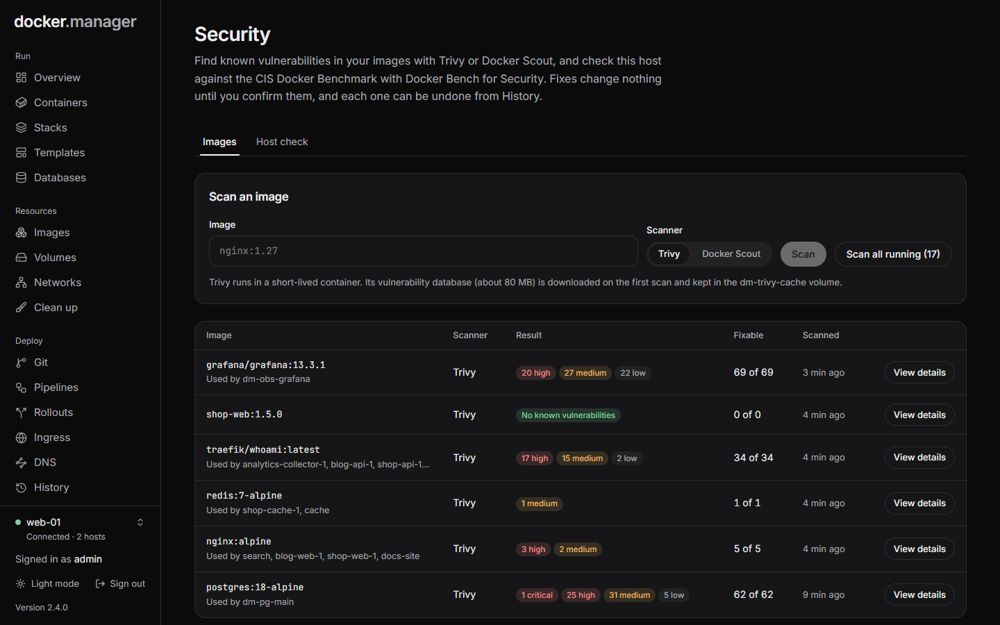
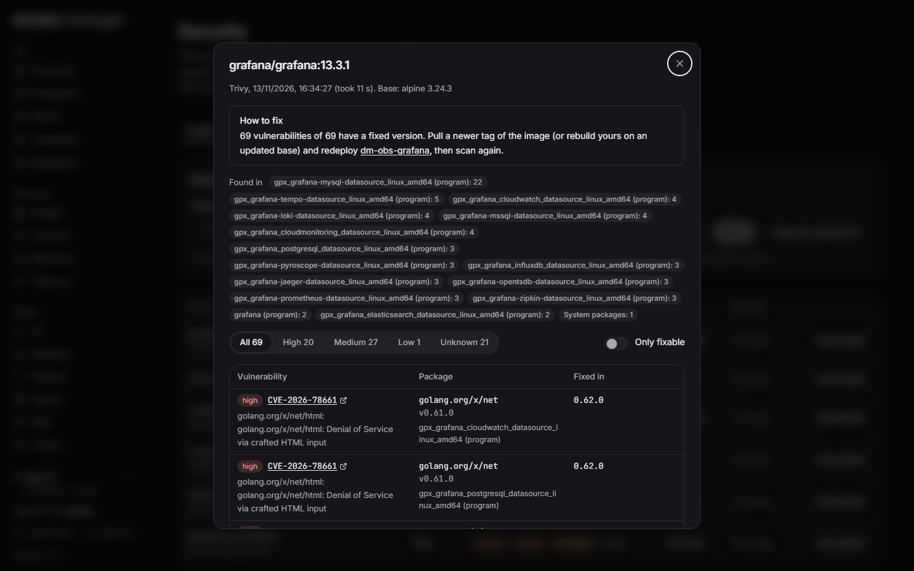
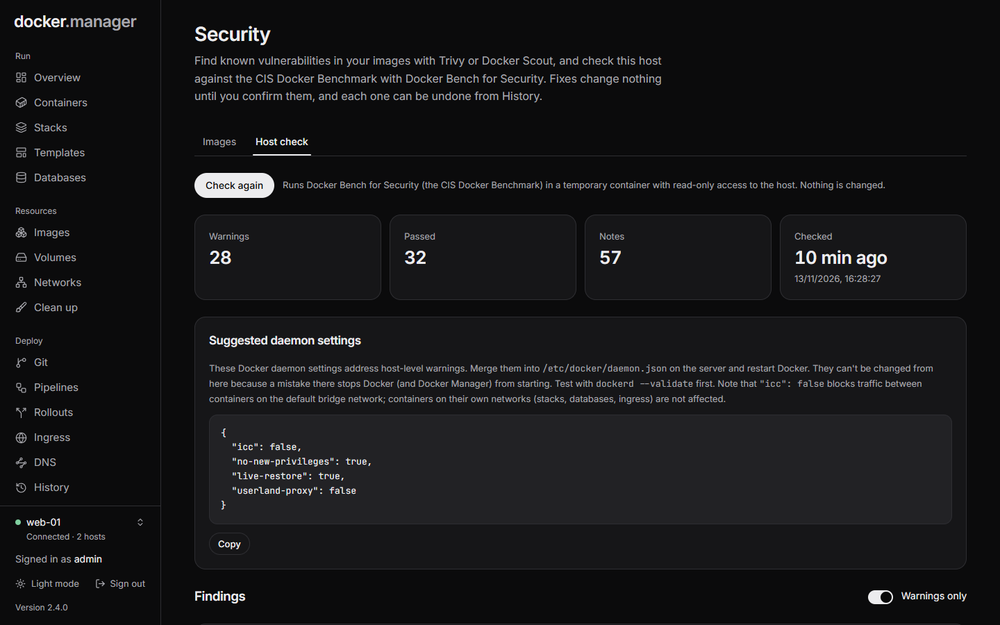

**Security** brings three tools together. Each runs in a short-lived container on the host it checks.

- **Trivy** (`aquasec/trivy`) scans images for known vulnerabilities and shows which ones have a fixed version.
- **Docker Scout** gives a second opinion on images.
- **Docker Bench for Security** checks the host, the Docker daemon's settings and every running container against the
  CIS Docker Benchmark. It mounts the host's configuration read-only and changes nothing.

Fixes change nothing until you confirm them, and each one can be undone from [History](/docs/admin/history/). Security
scans are for administrators.

## Scan images

On the **Images** tab:

- **Scan an image**: enter an **Image** (such as `nginx:1.27`), choose the **Scanner**, and press **Scan**.
- **Scan all running**: scans every image your running containers use, two at a time.

**Trivy** keeps its vulnerability database (about 80 MB, downloaded on the first scan) in the `dm-trivy-cache`
volume between scans. **Docker Scout** needs a Docker Hub sign-in: add Docker Hub under
[Registries](/docs/data/registry/#sign-ins) (a personal access token works).

The list shows each image's latest scan with its result and how many findings are fixable. **View details** opens the
report.

## Read a report

A report lists each vulnerability with its **Package**, **Severity** and the version it is **Fixed in** (or **Not
yet**). Filter by severity, or tick **Only fixable** to see what an update would solve.

The report also says **How to fix**: how many findings have a fixed version, and which containers use the image. Pull
a newer tag of the image (or rebuild yours on an updated base) and redeploy them. When an image is built on a base
system that is no longer supported, the report says so: it gets no more security updates, so rebuild it on a
supported base image.

Findings in Docker Manager's own image are fixed by updating Docker Manager: on the server, run
`docker compose pull && docker compose up -d` in its folder once a newer version is out, then scan again.

## Check the host

The **Host check** tab runs Docker Bench for Security. Press **Check this host** (or **Check again**). It looks at the
host, the Docker daemon's settings and every running container, and lists **Warnings**, **Passed** checks and
**Notes**. Tick **Warnings only** to focus on what needs attention.

### One-click fixes

Where a finding can be fixed safely, a **Fix** button explains exactly what will change and does nothing until you
press **Apply**:

| Fix | What it does |
| --- | --- |
| **Block privilege escalation** | Adds the security option `no-new-privileges:true`, so processes can't gain extra privileges, for example through setuid programs. |
| **Limit the number of processes** | Sets a process limit (1024 suggested), so a fork bomb or runaway process can't exhaust the host's process table. |
| **Limit memory** | Sets a memory limit, suggested from the container's current use with headroom, so it can't use up all of the host's memory. |

Docker can't change these on a running container, so the container is recreated with the same image, volumes,
networks and settings. It is down for a few seconds; if the new container doesn't start, the original is put back.
Each fix is recorded in **History**, where you can undo it.

Containers that belong to a stack are changed in their compose file instead: you get the line to add.

### Daemon settings

Findings about the Docker daemon itself come with **Suggested daemon settings**: a `daemon.json` to apply on the server
yourself, in `/etc/docker/daemon.json`. Check it with `dockerd --validate` before restarting Docker. Docker Manager
doesn't apply these, because a mistake there would stop Docker from starting.

:::note
Docker Bench for Security is included with Docker Manager (Apache License 2.0), because its published image can no
longer talk to current Docker versions.
:::

## Image rules

To stop untrusted images from being used at all, see [Image rules](/docs/watch/policies/).
